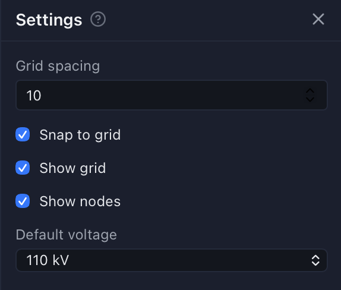

# SLD Editor — Руководство пользователя

SLD Editor — редактор однолинейных схем электрических сетей, работающий в браузере. Схема сохраняется в файл
`.xsld` (основной источник данных) вместе с изображением `.svg` в формате xsde2svg, который используют SCADA-системы.

Это руководство описывает работу с редактором. Установка и запуск описаны в `README.md`.

Впервые в редакторе? Начните с раздела [Как нарисовать схему: пошаговая инструкция](#how-to). Работаете со схемами РСДУ?
См. [Как работать с РСДУ](#rsdu-howto).

## Окно программы {#window}

- **Левая панель кнопок**: кнопки панелей **Файл**, **Элементы**, **Объекты** (только когда включены
  [привязки](#configuration-bindings)) и **Настройки** (они открываются на одном месте слева, одна за раз), переключатель
  панели **Свойства**, переключатель [обзора привязок](#bindings-overview) (только когда включены привязки), а внизу —
  **Справка** (это руководство) и **О программе**.
- **Холст**: сама схема; кнопки масштаба — в правом нижнем углу.
- Панель **Свойства** располагается справа и может быть открыта одновременно с панелью «Элементы».
- **Обзор привязок** располагается под холстом и может быть открыт вместе с панелями по обе стороны.

Во вкладке браузера показано имя открытой схемы, а `*` — если в ней есть несохранённые изменения. Редактор
защищает их от потери: см. раздел [Несохранённые изменения](#unsaved).

### Руководство пользователя {#user-guide}

**Справка** открывает это руководство в окне, которое можно держать рядом с холстом; кнопка **?** диалога или панели
открывает его на соответствующем разделе. Поле над содержанием фильтрует заголовки. Картинка показывается как
пронумерованный рисунок; щелчок открывает её в полном размере в новой вкладке.

Кнопка с принтером (вверху справа) печатает руководство: выберите принтер **Сохранить как PDF**, чтобы получить файл
PDF. Распечатка начинается с содержания, ссылки в ней работают внутри PDF.

## Как нарисовать схему: пошаговая инструкция {#how-to}

В этом примере строится простая ячейка отходящей линии: шина, под ней разъединитель и выключатель, заземляющий
разъединитель между ними и кабельная линия, выходящая из ячейки. Каждый шаг ссылается на раздел с подробным описанием.

### Шаг 1. Создайте схему {#how-to-create}

1. Нажмите **Файл** на левой панели кнопок.
2. В обзоре папок перейдите в папку, где должна храниться схема.
3. Нажмите **Новая схема**, введите имя, **ширину** и **высоту** листа и **напряжение по умолчанию** (например,
   10 кВ), затем подтвердите.

Откроется пустой лист, а панель «Свойства» справа покажет свойства самой схемы. См.
[Создание и открытие](#create-open).

### Шаг 2. Проверьте сетку {#how-to-grid}

1. Нажмите **Настройки** на левой панели кнопок.
2. Оставьте включёнными **Привязка к сетке** и **Показывать сетку**: тогда аппараты и провода выравниваются и
   соединяются точно.
3. Включите **Показывать узлы**, чтобы видеть каждую точку подключения в виде крестика (зелёный — подключено,
   красный — свободно).

См. [Настройки](#settings).

### Шаг 3. Нарисуйте шину {#how-to-busbar}

1. Нажмите **Элементы** на левой панели кнопок и раскройте группу **Шины**.
2. Щёлкните **Секция шин**, чтобы выбрать инструмент.
3. Нажмите на холсте в начале шины, протяните до её конца и отпустите кнопку.
4. В панели «Свойства» введите **Имя** и проверьте **Класс напряжения**.

См. [Размещение элементов](#placing).

### Шаг 4. Разместите аппараты {#how-to-devices}

1. Раскройте **Коммутационные аппараты**, щёлкните **Разъединитель**, затем щёлкните на холсте под шиной.
2. Так же выберите **Выключатель** и щёлкните под разъединителем. Размещение однократное: для каждой копии элемент
   нужно выбрать заново.
3. Чтобы повернуть аппарат, выделите его и нажмите **R** (на 90° по часовой стрелке; **Shift+R** — против) или
   **M** (отразить), либо измените **Ориентация** (или **Отразить**) в панели «Свойства»; его выводы и подключённые
   к ним провода поворачиваются вместе с ним. Если выделено несколько объектов, каждый аппарат поворачивается вокруг
   своей точки привязки; объекты без ориентации не меняются. **R** поворачивает и выделенную надпись, вокруг её точки
   привязки (**Поворот** в панели «Свойства» принимает любой угол; **M** её не меняет).
4. Чтобы переместить аппарат, удерживайте **Ctrl** (на Mac — **Cmd**) и перетащите его. Обычное перетаскивание
   сдвигает холст.

Совет: если вывод аппарата положить точно на шину, он подключится к ней без провода. См.
[Перемещение, копирование и удаление](#moving) и [Соединения](#connections).

### Шаг 5. Соедините проводами {#how-to-wiring}

1. Раскройте **Провода** и щёлкните **Ошиновка**.
2. Удерживая **Ctrl**/**Cmd**, щёлкните по шине над разъединителем, чтобы начать провод там (или щёлкните по
   крестику вывода аппарата, чтобы начать от него).
3. При необходимости щелчками добавьте изломы; провод остаётся горизонтальным/вертикальным.
4. Щёлкните по верхнему выводу разъединителя, чтобы закончить. После каждого провода инструмент сбрасывается.
5. Снова выберите **Ошиновка** и соедините нижний вывод разъединителя с верхним выводом выключателя.

**Esc** отменяет рисуемый провод. См. [Провода](#wiring).

### Шаг 6. Добавьте заземляющий разъединитель на отпайке {#how-to-tap}

1. Раскройте **Заземление**, выберите **Заземляющий разъединитель** и поставьте его рядом с проводом между
   разъединителем и выключателем.
2. Выберите **Ошиновка**, щёлкните по выводу заземляющего разъединителя и закончите щелчком по середине этого
   провода. Провод разделится в этой точке, и появится настоящее соединение.

См. [Провода](#wiring) и [Редактирование провода](#editing-wire).

### Шаг 7. Нарисуйте отходящую линию {#how-to-line}

1. В группе **Провода** выберите **Кабельная линия** (или **Воздушная линия**).
2. Щёлкните по нижнему выводу выключателя, добавьте изломы и дважды щёлкните, чтобы закончить линию в свободной
   точке (или щёлкните по выводу другого аппарата).
3. Линия получит автоматическое имя (`Кабельная линия-12`); выделите её, чтобы переименовать в панели «Свойства».

### Шаг 8. Задайте имена и надписи {#how-to-names}

1. Выделите аппарат и введите его **Имя** в панели «Свойства».
2. Нажмите значок надписи рядом с именем, чтобы добавить рядом с аппаратом текстовую надпись с этим именем.
3. Произвольный текст (заголовки, примечания) размещается элементом **Текст**.

См. [Свойства](#properties).

### Шаг 9. Проверьте соединения {#how-to-check}

1. При включённом **Показывать узлы** ищите красные крестики: каждый — это неподключённый вывод или конец провода.
2. Выделите аппарат: раздел **Соединения** в панели «Свойства» перечисляет его выводы и то, что к ним подключено.
3. Устраните разрыв, нарисовав к нему провод, или через правый щелчок → **Топология** → **Соединить с…**, если
   элементы на рисунке уже касаются.

См. [Соединения](#connections).

### Шаг 10. Быстро повторите ячейки {#how-to-repeat}

- Выделите готовую ячейку (удерживая **Ctrl**/**Cmd**, обведите её рамкой), затем нажмите **Ctrl+C** / **Ctrl+V**
  или перетащите её с **Alt**, чтобы поставить копию вместе с проводами.
- Чтобы использовать ячейку в других схемах, выберите правый щелчок → **Сохранить как пользовательский элемент…**;
  она появится в группе **Пользовательские элементы** панели «Элементы».

См. [Выделение](#selecting) и [Пользовательские элементы](#custom-elements).

### Шаг 11. Сохраните и экспортируйте {#how-to-save}

1. Щёлкните по пустому месту холста, чтобы снять выделение; панель «Свойства» покажет схему.
2. Нажмите **Сохранить**: файлы `.xsld` и `.svg` запишутся в папку на сервере.
3. В разделе **Экспорт** выберите **SVG** или **XSLD** и нажмите **Скачать**, чтобы сохранить файлы на свой компьютер.

При желании перед сохранением распределите объекты по [слоям](#layers). См. [Сохранение и экспорт](#save-export).

## Схемы и файлы {#files}

### Создание и открытие {#create-open}

- **Файл → Новая схема** запрашивает имя, ширину и высоту листа и напряжение по умолчанию. Схема создаётся в
  папке, которая сейчас открыта на панели «Файл»; имя может содержать `/`, чтобы создать схему во вложенной папке.
- **Файл → Открыть** — это обзор папок: щелчок по папке открывает её, `..` — переход на уровень выше, щелчок по
  схеме открывает схему.
- Если у открытой схемы не задано напряжение по умолчанию, редактор предложит его выбрать. Оно назначается вновь
  размещаемым элементам и проводам.
- Разные системы рисуют один и тот же уровень напряжения немного разными цветами. Если цвет класса напряжения схемы
  близок к одному из стандартных цветов сервера (в пределах расстояния RGB, заданного `voltage_color_tolerance`, 60
  в поставляемой конфигурации), то же окно показывает его в разделе **Привести цвета к стандартным**, например `#d01025` → `#d02020`
  220 kV. Отмеченные классы получают стандартный цвет, а также его имя, если своего имени у них нет (только код
  цвета). Если в схеме уже есть класс с таким именем, они объединяются (в строке написано «объединить»): всё из
  класса с кодом цвета переходит в именованный класс, а дубликат удаляется. Имя, введённое вами, сохраняется, меняется
  только цвет. Всё, что нарисовано в этом классе, перекрашивается. Каждый цвет сопоставляется только с ближайшим
  стандартным. **Свойства → Классы напряжения → Привести к стандартным цветам…** открывает список повторно.

### Папки {#folders}

- **Файл → Новая папка** создаёт пустую папку в папке, которую показывает панель «Файл». Имя может содержать `/`,
  чтобы сразу создать вложенные папки.
- Наведите указатель на папку или схему в обзоре папок, чтобы появились кнопки **Переименовать или переместить**
  (карандаш) и **Удалить** (корзина), а через мгновение — полное имя, если оно не помещается в панели.
- **Переименовать или переместить** запрашивает новый путь от верхней папки, заполненный текущим. Измените последнюю
  часть, чтобы переименовать, или папку в пути, чтобы переместить (например, `region1/sub-5` → `archive/sub-5`).
  Недостающие папки создаются. Папка перемещается вместе со всем содержимым; переместить её внутрь неё самой нельзя.
  Если переименована или перемещена открытая схема (сама или вместе с папкой), она остаётся открытой под новым
  именем, адрес страницы тоже меняется, а несохранённые изменения сохраняются.
- **Удалить** сначала спрашивает подтверждение; отменить удаление нельзя. У схемы удаляются `.xsld` и `.svg`.
  Удалить можно только пустую папку. Удаление открытой схемы закрывает её, редактор остаётся пустым
  (несохранённые изменения теряются, о чём предупреждает окно), поэтому можно удалить и последнюю схему папки, а затем саму папку. Схему
  (или папку, где что-то есть), открытую в другой вкладке, удалить нельзя: окно показывает эти вкладки, и кнопка
  «Удалить» недоступна, пока они её не закроют (вкладка считается открытой ещё около двух с половиной минут после
  последней связи).
- Оба окна показывают другие вкладки (по IP-адресу), в которых открыта эта схема или что-то из папки. Эти вкладки
  об изменении не узнают: сохранение в них запишет схему под старым именем.

### Импорт {#import}

- Перетащите файлы `.xsld`, `.svg`, `.xsde` или CIM (`.zip`, `.xml`) в любое место окна или воспользуйтесь **Файл → Загрузить из файла…**.
  Пока файл загружается и преобразуется (большая модель CIM — несколько секунд), на холсте видно **Импорт <имя>…**,
  а панель «Файл» ждёт.
- Схема Modus `.xsde` сначала преобразуется xsde2svg, а затем импортируется как её `.svg`. Одностраничный `.xsde`
  открывается в редакторе; каждая страница многостраничного сохраняется в текущую папку как `<имя>`, `<имя>_1`,
  `<имя>_2`…, как при импорте нескольких файлов, и первая сохранённая страница открывается в редакторе. Итоговое окно
  сообщает, что в файле несколько схем и какая из них открыта; остальные открываются из панели «Файл».
- Один файл открывается в редакторе как несохранённая схема; модель CIM при этом сразу сохраняется. Если схема с таким
  именем уже есть в текущей папке, редактор спросит, загружать ли её (при сохранении, а для модели CIM — при самом
  импорте, она будет перезаписана).
- Несколько файлов сразу сохраняются прямо в текущую папку; файлы с уже существующими именами пропускаются, а в
  итоговом окне их можно перезаписать.
- При импорте `.svg` (рисунка xsde2svg) показывается **журнал импорта**: что распознано, какие классы напряжения
  найдены и что пропущено. **Файл → Показать журнал импорта** открывает его повторно.
- В журнале импорта `.xsde` есть ещё **сообщения конвертера**: ошибки, предупреждения и замечания xsde2svg (тип
  объекта, который он не умеет рисовать, ненайденный пользовательский элемент…). Для нескольких страниц или файлов в
  итоговом окне указано число сообщений каждой страницы; щёлкните по нему, чтобы их увидеть. Файл, который вообще не
  удаётся преобразовать (например, повреждённый XML), показывается с причиной ошибки. Цвета и настройки
  конвертера берутся из `xsde2svg.yml` и `workplace.xml`, см. [Конфигурация](#configuration-xsde). Файл, в заголовке которого
  указана кодировка UTF-8, а текст на самом деле в Windows-1251 (так бывает в некоторых выгрузках Modus), читается как
  Windows-1251, а в сообщениях конвертера появляется предупреждение.
- Типы элементов, которые рисуются так же, как другой, импортируются как он: присоединение Ж/Д (71) и контакт
  дугогасительный (320006) становятся **разъединителем** (162), автоматика (103) — **табло** (102), картинка-файл (12) —
  **подложкой** (11). Контакт дугогасительный сохраняет удлинённые выводы (**Выводы**), поэтому провода остаются
  подключены. Ранее сохранённые схемы остаются без изменений.
- Тексты сохраняют поворот: угол наклона текста Modus (против часовой стрелки) вместе с его ориентацией (вертикально
  вниз, перевёрнуто, вертикально вверх) поворачивают надпись так, как её рисует xsde2svg, вокруг её точки привязки.
- xsde2svg рисует каждый аппарат со своим шагом размера (каждый шаг в √2 раз больше, от −2 до 5). Начиная с xsde2svg
  1.4.28 в `.svg` записаны шаг размера и зеркальность аппарата (`data-scale`, `data-mirror`), и импорт берёт их
  оттуда. Для `.svg` более старого xsde2svg шаг восстанавливается по положению точек подключения аппарата, и символ
  заполняет промежуток между проводами. Аппараты, у которых выводы тоже удлиняются индивидуально (выключатели,
  разъединители и подобные), получают размер по нарисованному корпусу, а **Выводы** — по двум точкам подключения.
  Силовой трансформатор получает размер по своим окружностям, зеркальность и сторону вывода каждой обмотки
  (**Ориентация вывода**) — по рисунку, а регулируемую обмотку — по стрелке регулирования.
- Вывод аппарата, который заканчивается в одной-двух единицах сбоку от провода (Т-образное подключение, например
  заземляющий разъединитель на присоединении), при импорте подключается к этому проводу с его разделением.
- Провод, который заканчивается на середине другого провода (Т-образное соединение ошиновки), сам или вместе с выводом
  аппарата, подключается к нему так же; воздушная линия для этого не разделяется.
- Узел соединения (точка) означает, что всё, что пересекается в этом месте, соединено: каждый проходящий через неё
  провод, включая воздушные линии, разделяется в точке и подключается к ней и к шине под ней. Провода, пересекающиеся
  без точки, остаются раздельными.
- В схемах, импортированных до появления этих двух правил, они применяются кнопкой **Исправить схему** (см.
  [Исправление схемы](#repair)).

### Файлы CIM: профили и имена {#cim-files}

Модель CIM в европейском формате CGMES (Common Grid Model Exchange Standard, версии 2.4.15 и 3.0) — это не один
файл, а набор документов RDF/XML (IEC 61970-552), по одному на **профиль**, обычно упакованных в `.zip`. Каждый
профиль описывает одну сторону одной и той же сети; документы ссылаются на объекты друг друга по идентификатору
(`rdf:ID` / `rdf:about="#…"`, `mRID` объекта). Каждый документ начинается с заголовка (`md:FullModel`): его
идентификатор, время создания и сценария, профиль или профили, которые он содержит (`md:Model.profile`, например
`http://iec.ch/TC57/ns/CIM/CoreEquipment-EU/3.0`), и документы, от которых он зависит (`md:Model.DependentOn`);
например, файл SSH зависит от файла EQ той же сети.

**Имена файлов.** Обычное соглашение — `<дата>T<время>Z_<процесс>_<область>_<профиль>_<версия>.xml`:

- `<дата>T<время>Z` — время сценария в UTC, например `20201202T1843Z`.
- `<процесс>` — бизнес-процесс: `1D` на сутки вперёд, `2D` на двое суток, `ID` внутри суток, `YR` на год…
- `<область>` — кто составил модель (системный оператор, например `BE` или `NL`, регион, имя модели) или
  `ASSEMBLED` для объединённой модели.
- `<профиль>` — код профиля из таблицы ниже. `_BD` означает общий **граничный** набор (boundary), единый для всех
  участников.
- `<версия>` — версия файла, например `001`.

Так, `20201202T1843Z_1D_Svedala Area_EQ_001.xml` — оборудование тестовой модели Svedala для процесса «на сутки
вперёд» на 2 декабря 2020 г., 18:43 UTC. Имена — лишь соглашение: что содержит документ, говорит его заголовок, а
редактор смотрит на содержимое, а не на имя.

| Код | Профиль | Содержит | Импорт | Экспорт |
|---|---|---|---|---|
| EQ | Equipment, оборудование (в CGMES 3.0 — Core Equipment) | Оборудование и его соединения: подстанции, классы напряжения, базовые напряжения, шины, коммутационные аппараты с нормальным положением, трансформаторы и их обмотки, линии, нагрузки, генераторы, полюса (terminals) и узлы связности, номинальные данные и сопротивления | Читается: сама сеть | Записывается (`<имя>_EQ.xml`) |
| OP, SC | Operation, Short Circuit (CGMES 3.0) | Части EQ, выделенные в 3.0: измерения и пределы; данные для расчёта токов КЗ. Часто в одном файле с EQ (тогда его заголовок перечисляет несколько профилей) | Объединяется, не используется | Не записывается |
| EQ_BD | Граничное оборудование (EQBD в 3.0) | Точки на границе областей: граничные узлы связности, их базовые напряжения и линии к соседям | Читается вместе с EQ, если есть в архиве | Не записывается |
| TP | Topology, топология | Топологические узлы (шины): какие узлы связности соединены замкнутыми аппаратами; в модели «шина — ветвь» (bus-branch) других узлов нет | Читается: в модели bus-branch топологические узлы заменяют узлы связности | Не записывается |
| TP_BD | Граничная топология (2.4.15) | Топологические узлы границы | Как TP | Не записывается |
| SSH | Steady State Hypothesis, исходный режим | Режим для расчёта: текущее положение аппаратов (`open`), P и Q нагрузок, уставки генераторов, положения отпаек, регулирование | Объединяется, не используется (положение аппарата берётся из `normalOpen` в EQ) | Не записывается |
| SV | State Variables, переменные состояния | Результаты расчёта потокораспределения: напряжения и углы узлов, перетоки, ступени отпаек, что в работе | Объединяется, не используется | Не записывается |
| DL | Diagram Layout, графическое размещение (IEC 61970-453) | Схемы: где нарисован каждый объект (точки, поворот), тексты, слои видимости | Читается: каждая схема — отдельная страница; без DL раскладка строится автоматически | Записывается (`<имя>_DL.xml`) |
| GL | Geographical Location, география | Координаты оборудования на карте (места, точки, система координат) | Объединяется, не используется | Не записывается |
| DY | Dynamics, динамика | Модели для расчёта динамики (машины, возбудители, регуляторы) | Объединяется, не используется | Не записывается |

Все файлы `.xml` и `.rdf` архива читаются и объединяются, как бы они ни назывались; то, что редактор не использует,
просто ни на что не влияет. Для схемы достаточно одного документа EQ (см. [Импорт из CIM](#cim-import)).

**`<NN>_<подстанция>_metadata.json`.** Этот файл не относится к CIM. Его пишет рядом с каждым нарисованным SVG
построитель однолинейных схем PowSyBl: например, `tools/cim-tools render <модель> out/` пишет
`out/00_<подстанция>.svg` и `out/00_<подстанция>_metadata.json` (см. `docs/CIM_INTEROP.md`). Это объект JSON,
связывающий SVG с сетью, чтобы приложение, показывающее SVG, могло сделать его интерактивным (подсветить, открыть,
переключить нужное оборудование):

- `metadataVersion` — версия формата (например, `1.1`).
- `components` — использованные типы символов (`BUSBAR_SECTION`, `BREAKER`, `DISCONNECTOR`,
  `TWO_WINDINGS_TRANSFORMER`…) с размером и классом CSS.
- `nodes` — каждый нарисованный символ: `id` его элемента SVG, класс напряжения (`vid`), `componentType`,
  `equipmentId` в сети (mRID CIM), разомкнут ли аппарат (`open`) и подписи.
- `wires` — каждый нарисованный провод: его `id` в SVG и два соединяемых узла.
- `lines`, `feederInfos`, `busInfos` — концы линий, уходящих с подстанции, стрелки и значения на присоединениях,
  легенды шин.
- `layoutParams`, `svgParams` — параметры, с которыми рисовал PowSyBl (размеры ячеек, отступы; подписи и единицы).
- `networkId`, `networkName`, `networkDate` — сеть, по которой нарисована схема.

Редактор эти файлы не читает и не пишет; импортируйте сам архив CIM.

### Импорт из CIM {#cim-import}

Модель CIM в виде `.zip` с файлами профилей CGMES или одного файла RDF/XML `.xml` (оборудование — из EQ, шины
модели bus-branch — из TP, схемы — из DL; остальные профили читаются, но не используются, см.
[Файлы CIM](#cim-files)) импортируется как `.xsde`: каждая схема её графического профиля (DL) становится отдельной схемой. Единственная
сохраняется в текущую папку как `<имя>` и открывается; несколько сохраняются в папку внутри текущей, названную по имени файла, каждая под именем своей схемы DL
(при автоматической раскладке — своей подстанции), например `<имя>/AGGAN CT11`; уже существующее имя пропускается. Читаются CGMES 3.0 и 2.4.15, а файл,
выгруженный этим редактором, возвращается таким, каким был нарисован. Читаются модели как с коммутационными узлами
(node-breaker), так и расчётные (bus-branch): в них вместо узлов соединения используются топологические узлы. Из zip
читаются все файлы `.xml`/`.rdf` в любых папках; скрытые файлы (имя начинается с точки) и папка `__MACOSX`, которую
добавляет команда macOS **Сжать**, пропускаются.

Если у модели есть графическое размещение, сделанное другой программой или выгруженное этим редактором, импорт
спрашивает, как её рисовать (**Графическое размещение модели**). Окно показывает, кем выгружен файл, по заголовку его
документа размещения: источник (`urn:sld-editor` для этого редактора), описание и время создания.

- **Взять размещение модели**: каждая её схема становится страницей, нарисованной так, как всё расставила та
  программа; файл, выгруженный этим редактором, возвращается точно таким, каким был нарисован. Размещения других
  программ часто — обзорные схемы сети: одна схема на все подстанции, аппараты близко друг к другу, без надписей. Схема, в которой нет ни одной надписи, получает имена оборудования из EQ: справа от вертикального
  аппарата, над горизонтальным (отступая дальше, где имена наложились бы друг на друга или на шину), над концом шины и
  рядом с линией.
- **Разложить автоматически**: размещение не используется, и каждая подстанция получает свою страницу, разложенную
  как для модели без размещения (см. ниже), с именами.

Модель без размещения импортируется без вопроса.

- Каждый аппарат становится символом своего класса CIM в точке, заданной схемой, с поворотом, кратным 90°, с именем,
  классом напряжения (по одному на базовое напряжение, с названием вида «110 kV» и цветом стандартного напряжения того же
  значения, см. [Классы напряжения при импорте из CIM](#cim-voltage-colors); уровень напряжения без базового
  напряжения, которое часто лежит в файле, не переданном вместе с моделью, получает напряжение из своего названия, как
  «ОРУ-110 кВ» или «6,3 kV»; базовое напряжение, которого по-прежнему нет, берётся как самое частое номинальное
  напряжение обмоток трансформаторов на нём, иначе как медиана измеренного напряжения (файл SV) его узлов,
  округлённая до уже найденного класса в пределах 15% или до ближайшего стандартного напряжения, с записью в журнале
  импорта; номинальное напряжение выше 2000 кВ, какого нет ни в одной сети, берётся как есть с
  предупреждением в журнале импорта: `nominalVoltage` в CIM задаётся в кВ, и такой файл, вероятно, записал вольты),
  положением коммутационного аппарата (`normalOpen`) и [электрическими параметрами](#electrical-parameters).
  Если у символа есть выбор, класс сохраняется как его **Класс CIM** (асинхронная машина становится двигателем с
  классом AsynchronousMachine). Нагрузки, внешние сети и СТК получают символы Нагрузка, Внешняя сеть и Статический
  тиристорный компенсатор.
- Участки линий (ACLineSegment) становятся воздушными линиями по точкам схемы (кабельными, если это указано в схеме),
  с их параметрами. Надписи (а где размещение их не задаёт — имена) и слои видимости переносятся. Потребитель или источник, выгруженный этим редактором как
  связь с объектом, возвращается связью с объектом.
- Каждый аппарат, линия, полюс, обмотка трансформатора и узел соединения сохраняют свой идентификатор CIM (mRID) в
  файле схемы, так что повторный экспорт пишет те же идентификаторы (см. [Экспорт в CIM](#cim-export)). Панель
  «Свойства» показывает **mRID** выделенного аппарата или линии (только для чтения, со значком копирования рядом с подписью), а
  [Поиск](#find) находит объект по его mRID или mRID одного из его полюсов.
- Соединения берутся из модели, а не из рисунка: два объекта соединены, только если они в одном узле, как бы схема
  их ни располагала, и импорт из CIM не проходит через **Исправить схему** (она соединяет всё, что касается;
  для такой схемы её лучше не применять). Перемычки и точки соединения ставятся по тем же правилам, что и при
  рисовании вручную ([Провода](#wiring)): провод ошиновки, пересекающий шину, другой провод ошиновки или линию
  другого класса напряжения, получает одну **перемычку** (одну на пересечение), а каждое подключение ошиновки к шине —
  точку соединения. Пересечение проводов одного класса напряжения остаётся обычным пересечением, хотя они и не
  соединены. Журнал импорта считает перемычки и пересечения, где для перемычки не хватило места.
- Провода, нарисованные в схеме для узла, сохраняются. Всё, что они оставили неподключённым, соединяется с остальной
  частью узла ортогональным проводом, а при наличии шины — с шиной; число таких проводов указано в журнале импорта.
  Аппарат, вывод которого лежит над шиной или под ней, опускается на неё прямым проводом, как при ручном рисовании,
  а не соединяется вбок с выводом соседа.
- Схемы из других программ часто рисуют меньше, чем выгружает этот редактор, и при импорте дополняются:
  - Шина, нарисованная только как её узел соединения (линия для узла, но не для BusbarSection), становится этой
    шиной; узел, нарисованный короткой чертой меньше двух шагов сетки, лишь обозначает соединение и не рисуется.
  - Вывод, нарисованный ломаной от аппарата к его узлу, становится проводом от вывода символа, если только он не
    проходит по другому аппарату или выводу другого узла; тогда соединение прокладывается автоматически.
  - Каждый аппарат поворачивается так, чтобы его выводы оказались там, где их рисует схема, на четверть или пол-оборота,
    если символ лежит на другой оси (трансформатор, нарисованный вертикально); аппарат без нарисованных выводов
    поворачивается выводами к тому, с чем он соединён. Провод не проходит через аппарат к его дальнему выводу.
    Аппарат с одним выводом (нагрузка, внешняя сеть, генератор), символ которого нарисован поверх его собственного
    провода, поворачивается от провода.
  - Линия, которую схема не рисует, идёт от своего аппарата к значку подстанции на другом её конце (объект
    Substation), в сторону, если путь прямо занят, или короткой отпайкой; она подписана своим именем. Журнал импорта
    считает такие концы линий. Шина или аппарат, которых схема не размещает на листе, на нём не рисуются.
- Схема в других единицах масштабируется так, чтобы соседние аппараты были примерно в шести шагах сетки друг от друга,
  выравнивается по сетке и переворачивается, если её ось y направлена вверх.
- Каким символом рисуется каждый класс CIM, задаёт конфигурация сервера (`cim.import`, см.
  [sld-editor.yaml](#configuration-editor)). Оборудование класса, для которого там нет символа (например, линия
  постоянного тока), рисуется там, где его размещает схема, красным прямоугольником с названием класса CIM внутри, ни
  с чем не соединённым, чтобы его можно было заменить вручную; оно перечислено в разделе **Пропущено** журнала импорта,
  с предупреждением. Автоматическая раскладка его не рисует.
- Модель с оборудованием, но без графического профиля (только EQ), раскладывается автоматически по образцу раскладки
  PowSyBl: отдельная схема на каждую подстанцию (и одна для оборудования вне подстанций), каждый класс напряжения —
  полоса, высшее напряжение сверху, с подписью слева от её шин (имя распределительного устройства, а без него — его
  напряжение).
  - Полосы стоят рядами, бок о бок, шины на одном уровне, а трансформаторы — в ряду между ними: то, к чему
    трансформатор понижает, идёт в ряд под полосой его высшей обмотки, так что две низшие стороны трёхобмоточного
    трансформатора стоят в одном ряду. Его среднее напряжение поднимается к высшему, если ряды от этого становятся
    ровнее (ВН и СН над НН, как часто рисуют вручную). Присоединение к трансформатору идёт к его ряду: вниз из ряда
    над ним, вверх из ряда под ним. Класс напряжения, к которому не подходит ни один трансформатор, стоит в нижнем
    ряду, а пустые ряды места не занимают.
  - Трансформатор, подключённый к схеме только в одном узле (трансформатор собственных нужд в конце кабеля),
    заканчивает своё присоединение, как нагрузка, а не стоит в ряду трансформаторов.
  - Шины, у которых есть общее присоединение, параллельны: это ряды во всю ширину, один под другим. Шины без общих
    присоединений стоят рядом.
  - Каждое присоединение (аппараты между шинами и тем, что оно питает) занимает собственные столбцы. Каждый аппарат,
    подключённый к шине, стоит в своём столбце и опускается прямо на свой ряд (с точкой соединения), пересекая шины
    перед ним; остальные аппараты стоят над аппаратами ниже них, а то, что присоединение питает (линия,
    трансформатор, нагрузка или генератор), — за ними; линия в другую подстанцию — коротким отрезком со своим именем.
  - Расстояния взяты из схем, нарисованных вручную: присоединения через 9 шагов сетки на шинах до 20 кВ и через 12
    выше, столбцы одного присоединения (его ветви к параллельным шинам) через 6, аппараты в присоединении через 6
    шагов (4 между выводами), первый вывод присоединения в 2 шагах от шины, а шина выходит на 2 шага за крайние
    присоединения. Имя аппарата стоит справа от него, на его же уровне; имя,
    слишком длинное для промежутка до следующего присоединения, получает свою высоту по номеру столбца. Связь, которую
    импорт добавляет между частями одного узла, изгибается так, чтобы не проходить по аппаратам.
  - Присоединение — одна прямая цепь от шины до того, что оно питает, с выключателями и разъединителями на ней.
    Заземление рисуется сбоку: заземляющий нож (или разъединитель, за которым он стоит, или заземление) на узле цепи
    поворачивается горизонтально и стоит в 2 шагах справа от цепи на уровне этого узла, с именем над ним; второй на
    том же узле уходит влево. Присоединение получает место, нужное его заземлению. Заземляющий нож прямо на шине
    сохраняет свой столбец.
  - Шиносоединительные присоединения (ничего не питающие), присоединения к трансформатору более высокого напряжения
    и, в верхней полосе, к линии идут над шинами, остальные — под ними. Трансформаторы стоят в ряду между полосами
    своих обмоток и подключаются по свободным коридорам, как и связи, замыкающие кольцо. Вывод никогда не проходит
    через другую полосу и не идёт вдоль провода или аппарата: где прямой путь закрыт (вывод трёхобмоточного
    трансформатора к полосе за соседней), он идёт в обход и пересекает провод поперёк, только если иначе нельзя.
    Вывод к трансформатору никогда не пересекает сам трансформатор: он подходит к обмотке снаружи, огибая
    трансформатор, если идёт с другой стороны, и никогда не пересекает и не идёт вдоль провода своего же узла.
    Если такого пути нет, вывод всё равно рисуется, а журнал импорта предупреждает об этом и называет трансформатор.
  - Затем раскладка упорядочивается, не меняя своего порядка: каждая группа шин со своими присоединениями сдвигается
    только целиком. Группы одного класса напряжения держатся вместе, рядом друг с другом в одном ряду; каждая встаёт
    под трансформатор, от которого питается (генератор — прямо под своим повышающим трансформатором), а ряд
    поднимается рядом с полосой выше, где ничто не мешает. Трансформаторы встают под питающие их присоединения или над
    тем, что они питают, так что их выводы идут прямо; где вывод должен повернуть, он делает один излом в своём
    коридоре, так что выводы никогда не пересекаются. Сдвиг сохраняется, только если уменьшает число пересечений (выводов между
    собой или с другим классом напряжения), а затем изломы выводов трансформаторов (излом под трансформатором весит
    больше) и их длину. Группы и трансформаторы не перекрываются, как и их подписи (имя класса напряжения переходит
    вправо от шин, когда мешает только оно), и всё остаётся на листе.
  - Класс напряжения без шины подвешивает присоединения к проводу в самом нагруженном узле. Журнал импорта сообщает,
    что раскладка создана автоматически.
- Не восстанавливается: значение, которое экспорт записал нулём, потому что оно не было задано, возвращается как
  настоящий 0; декоративные фигуры и цифровые приборы не выгружаются; оборудование, которое схема размещает на другом
  листе, на этом не рисуется.

### Напряжения обмоток трансформаторов {#cim-winding-voltages}

Трансформатор, у которого у всех обмоток одно и то же напряжение, неправдоподобен: скорее всего, модель задаёт
всем обмоткам один базовый класс напряжения, и тогда всё, что за трансформатором, оказывается не в той полосе
напряжения. Поэтому до раскладки диалог **Напряжения обмоток трансформаторов** показывает каждый такой
трансформатор с полем для каждой обмотки. В поле сначала стоит номинальное напряжение обмотки (`ratedU`), а без
него — напряжение из модели; оба показаны рядом.

- **Применить**: каждая изменённая обмотка получает своё напряжение, а с ней и всё, что к ней подключено до
  следующего трансформатора: шины, аппараты и линии. Они получают класс напряжения этого значения (с именем
  «<кВ> kV») и собственную полосу напряжения при автоматической раскладке. Если обмотка соединена с другой обмоткой
  того же трансформатора без трансформатора между ними, меняется только сама обмотка; журнал импорта сообщает об этом.
- **Оставить как в модели** (или Esc): напряжения модели сохраняются.

Вопрос задаётся и для модели со своим графическим размещением (классы напряжения в ней так же неверны), и для
каждого файла при импорте нескольких файлов.

### Классы напряжения при импорте из CIM {#cim-voltage-colors}

Класс напряжения CIM получает имя и цвет стандартного напряжения (`voltage_colors`) того же значения, поэтому «110 kV»,
«110kV» и «110.0 kV» совпадают со «110 kV». Если в модели есть напряжения, которых нет среди стандартных (например,
400 kV, когда конфигурация заканчивается на 330 kV), диалог **Новые классы напряжения** показывает их до того, как
что-либо будет открыто или сохранено:

- **Схем**: сколько схем модели используют этот класс.
- **Ближайший**: ближайшее к нему стандартное напряжение по отношению величин (400 kV → 330 kV, 17 kV → 10 kV,
  135 kV → 110 kV). Класс получает его цвет; если сравнивать не с чем, класс серый.
- **Цвет**: здесь можно изменить предложенный цвет.
- **Добавить** (отмечено): добавляет класс с его цветом в `voltage_colors` в файле конфигурации сервера, так что
  следующий импорт его узнает, и он сразу, без перезапуска, предлагается для новых классов. Комментарии в файле
  сохраняются; запись добавляется после последней в списке. Если файл конфигурации записать нельзя, диалог показывает
  причину и остаётся открытым: снимите **Добавить**, чтобы продолжить без этого.

**Применить** задаёт эти цвета всем импортированным схемам и добавляет отмеченные классы. **Оставить предложенные**
(или Esc) импортирует с предложенными цветами и ничего не добавляет.

### Сохранение и экспорт {#save-export}

Когда ничего не выделено, панель «Свойства» показывает саму схему:

- **Сохранить** записывает `.xsld` и его `.svg`. **Сохранить как** сохраняет копию под новым именем в той же папке.
- **Экспорт**: выберите формат и нажмите **Скачать**, чтобы сохранить схему на компьютер: **XSLD** (файл схемы),
  **SVG** (изображение) или **CIM, CGMES 3.0** для других программ расчёта и управления сетью (см.
  [Экспорт в CIM](#cim-export)). Последний выбранный формат запоминается в этом браузере. В SVG для rdss-dms каждый
  коммутационный аппарат должен быть в нормальном положении — **Open** или **Close**: rdss-dms рисует живое
  состояние аппарата от положения, в котором он экспортирован. После экспорта SVG аппараты в положении Intermediate,
  Faulty или без положения перечисляются под **Скачать** (щелчок по имени находит аппарат на холсте) — задайте
  положение и экспортируйте снова.
- **Ширина**, **Высота** и **Цвет фона** листа, а также **Слои** и **Классы напряжения** схемы (см. [Слои и классы напряжения](#layers)).
- **История**: когда и с какого IP-адреса схема сохранялась (см. [Несколько человек на одной схеме](#history)).

### Экспорт в CIM {#cim-export}

**Экспорт** в формате **CIM, CGMES 3.0** сохраняет zip-архив из двух файлов CIM (RDF/XML по IEC 61970-552, CGMES 3.0):
`<имя>_EQ.xml` — оборудование и его соединения, и `<имя>_DL.xml` — графическое размещение схемы (IEC 61970-453),
каждый со своим заголовком (DL зависит от EQ). Других профилей экспорт не пишет (см. [Файлы CIM](#cim-files));
программы вроде PowSyBl сами выводят топологию из EQ. Заголовок EQ указывает и профиль ShortCircuit, если экспорт
содержит данные для расчёта токов КЗ (нулевую последовательность линии, ударный ток шины). Как в моделях проверки
соответствия CGMES, у каждого оборудования есть `Equipment.aggregate`, а у каждого объекта схемы — имя. Экспорт
проверен на импорт в PowSyBl, но не проверялся по правилам CGMES ENTSO-E, поэтому это не полная модель CGMES (нет
SSH, TP и SV). Несохранённые изменения тоже попадают в экспорт.

- Схема делится на подстанции по соединениям: всё, что соединено, не проходя через линию, — одна подстанция
  (трансформаторы внутри), с именем её шины с наибольшим числом присоединений. Конец линии, рядом с которым нет
  оборудования (только провода, опоры и т. п.), относится к подстанции на другом конце линии. В каждой — распределительное
  устройство (VoltageLevel) на каждый класс напряжения, а воздушные и кабельные линии идут между подстанциями.
- Номинальное напряжение класса берётся из его названия («110 kV», «6,3 кВ», «400 В»; число без единиц — кВ); класс,
  всё ещё названный цветом, получает имя стандартного напряжения этого цвета (`voltage_colors`). Оборудование, класс
  которого не содержит напряжения, получает напряжение того, с чем оно соединено через аппараты; если рядом ничего с
  напряжением нет, берётся самое частое напряжение его подстанции (или схемы), и журнал экспорта об этом сообщает.
- Коммутационный аппарат или линия, оба конца которых в одном узле, не выгружаются, а трансформатор с 4 обмотками
  выгружается с замечанием: некоторые программы (например, PowSyBl) читают только 2 или 3 обмотки.
- Каждый аппарат становится своим классом CIM (выключатель, разъединитель, выключатель нагрузки, заземлитель,
  предохранитель, силовой трансформатор с обмотками, синхронная машина, шунтирующее или продольное устройство
  компенсации, секция шин, заземление) с выводом на каждую точку подключения. Переключающий рубильник становится двумя
  разъединителями от оси. Нормальное положение коммутационного аппарата берётся из его состояния; без состояния —
  включён.
- Некоторые символы могут обозначать разные классы CIM: выберите класс в списке **Класс CIM** на панели «Свойства»
  (он есть только у таких символов). Выключатель может быть выключателем-разъединителем, генератор или двигатель —
  асинхронной машиной, шунтирующий реактор — дугогасящей катушкой, пускатель — выключателем нагрузки, **Нагрузка** —
  типовой или нетиповой нагрузкой, а **Внешняя сеть** — эквивалентной инъекцией или источником энергии. Эти варианты
  и класс по умолчанию каждого символа задаются в конфигурации сервера (`cim.classes`, см. [sld-editor.yaml](#configuration-editor)).
  Символ, которого там нет, не выгружается, о чём сказано в примечаниях к экспорту.
- **Нагрузка**, **Внешняя сеть** и **Статический тиристорный компенсатор** (группа «Прочее оборудование» на палитре) —
  символы для оборудования CIM, которого нет на классических схемах: потребитель, связь с внешней сетью и СТК.
  Надпись в прямоугольнике статического тиристорного компенсатора — его **Текст надписи** в свойствах; если поле пустое, это `SVC`.
  Его **Ориентация вывода** в свойствах — Сверху (по умолчанию: прямоугольник под выводом) или Снизу (прямоугольник над
  выводом, надпись по-прежнему не перевёрнута); сам вывод остаётся на месте, и провод к нему не отрывается.
- Каждая воздушная или кабельная линия становится участком линии (ACLineSegment) в линии со своим именем.
- **Связь с объектом** обозначает внешний объект, на который она указывает: по умолчанию потребитель (EnergyConsumer),
  а если так выбрано в списке **Класс CIM** на панели «Свойства» — источник (EnergySource). Она подключается только
  своим началом; конец со стрелкой — это сам объект (**Обратное направление** меняет их местами), и то, что к нему
  подключено, отмечается и не выгружается. У связи-потребителя в [электрических параметрах](#electrical-parameters)
  есть P и Q.
- Ошиновка, точки подключения к шине, точки соединения, перемычки, опоры, кабельные муфты, трансформаторы тока,
  индикаторы КЗ и ВЧ-заградители объединяют всё, чего касаются, в один узел (ConnectivityNode). Трансформаторы тока и
  напряжения, ограничители перенапряжений, индикаторы КЗ и ВЧ-заградители выгружаются как вспомогательное оборудование
  на этом узле.
- Текстовые надписи становятся текстовыми объектами, привязанными к своему аппарату; слои — слоями видимости.
  Декоративные фигуры, цифровые приборы и изображения подстанций и электростанций не выгружаются.
- Идентификаторы (mRID): всё, что пришло из импорта CIM, сохраняет свои (аппараты, линии, их полюса, обмотки
  трансформаторов и узел соединения, все провода и полюса которого пришли из одного узла). Остальное получает
  идентификатор, построенный из имени схемы и номеров объектов, поэтому при повторном экспорте той же схемы он тоже не
  меняется: нарисованное в редакторе, копии (вставка, дублирование, свои элементы; копия — новое оборудование), узел,
  соединивший два импортированных, а также подстанции, классы напряжения и другие контейнеры, которые строит экспорт.
  Линия, разрезанная надвое, сохраняет идентификатор на первой части. Идентификатор, встретившийся дважды (файл,
  исправленный вручную), сохраняется один раз, остальные получают новые и перечисляются под строкой экспорта.
  Сохранённый идентификатор, который не является UUID (из источника, не следующего CGMES 3.0), записывается как есть
  и тоже перечисляется там.

Значения, которые нужны файлам, но отсутствуют в схеме (см. [Электрические параметры](#electrical-parameters)),
записываются как 0, а номинальное напряжение обмотки — как напряжение её класса (среди них статизм СТК и пределы
активной мощности внешней сети, которых требуют программы вроде PowSyBl). Под строкой экспорта перечисляются
такие объекты и недостающие значения, а также классы напряжения без напряжения в названии и аппараты, которые не
удалось выгрузить; щелчок по объекту подсвечивает его на холсте.

### Исправление схемы {#repair}

Схема, импортированная из `.svg` или `.xsde`, исправляется при импорте: каждый аппарат получает ровно свои
фиксированные порты на выводах, шина — порт в каждой точке, где к ней что-то подходит, концы проводов и выводы,
лежащие на проводе или на точке соединения, подключаются к ним, классы напряжения получают стандартные имена сервера,
а провода нулевой длины удаляются (см. раздел [Соединения](#connections)). Открытие схемы её соединения никогда не
меняет; исправляются только повторяющиеся или отсутствующие номера объектов, и схема тогда помечается как изменённая.

Схему, сохранённую до появления этих правил или изменённую вне редактора, можно исправить вручную: кнопка
**Исправить схему** в свойствах схемы (когда ничего не выделено) применяет то же исправление к схеме в её текущем
виде, вместе с несохранёнными изменениями. Это один шаг, который отменяется **Отменой**, и схема остаётся помеченной
как изменённая, пока вы её не сохраните. «Исправлять нечего» означает, что схема уже соответствует всем правилам.

### Буквенно-цифровые обозначения {#designations}

**Пронумеровать элементы…** (свойства схемы, когда ничего не выделено, или контекстное меню холста) даёт
оборудованию обозначения по МЭК 81346, построенные по топологии схемы, и записывает каждое как имя элемента:
`=E1=T1-QA1` — класс напряжения E1, трансформаторное присоединение T1, выключатель 1. Буквенный код элемента (`QA`,
`QB`, `TA`, …) берётся из `letter_codes`; элементы без кода, провода, надписи и графические фигуры не трогаются.

Как находятся узлы (положение коммутационных аппаратов не учитывается):

- **Классы напряжения.** Распредустройство, связанное проводами и аппаратами не через трансформатор и не через
  линию, — один класс напряжения, по самому частому в нём классу; буква берётся из `designations.voltage_levels`.
- **Узлы.** От каждой точки подключения к шине редактор идёт по схеме наружу, останавливаясь на других шинах,
  трансформаторах и линиях. Узел определяется тем, что достигнуто: трансформатор → **трансформаторное
  присоединение**; генератор или синхронный компенсатор → **генераторный блок**; только две шины и больше →
  **секционная / шиносоединительная ячейка**; только ТН (с его аппаратами, предохранителями, ОПН) → **ячейка ТН**;
  внешняя сеть или связь-источник → **ввод**; нагрузка или двигатель → **отходящее присоединение**; одна линия →
  присоединение, **предположительно** ввод на высшем классе напряжения своей сети и отходящее ниже; остальное →
  **прочее**.
- **Шины.** Секции шин на одной прямой, соединённые ячейкой, — одна система шин (`=W1`, секции `-WC1`, `-WC2`);
  параллельные — разные системы (`=W1`, `=W2`).
- **Трансформаторы.** Трансформатор относится к узлу своей стороны высшего напряжения (`=E1=T1-TA1`); сторона
  низшего напряжения — узел с тем же номером в своём классе напряжения (`=K1=T1`), и они связаны.

Номера идут по каждому буквенному коду в пределах узла с 1, по направлению потока энергии от шины наружу, затем в
порядке чтения; узлы нумеруются в порядке чтения их точек подключения к шине. Номера устойчивы: добавление или
удаление элемента не перенумеровывает остальные, а новый элемент получает обозначение, только когда команду
запускают снова, — следующий свободный номер своего узла.

Окно не закрывает схему: перетащите его за заголовок в сторону. Щелчок по строке выделяет её элемент и показывает его
на схеме, Ctrl/Cmd-щелчок добавляет его к выделению; выделенные строки подсвечены, как в обзоре привязок. В окне задаются:

- **Область**: вся схема или выделенные элементы;
- **Режим**: только элементы без обозначения или перенумеровать все в области;
- **Надписи показывают**: полное обозначение или только обозначение изделия без дефиса (`QA1`). В имени всегда
  остаётся полное. Чтобы краткая надпись по-прежнему называла один элемент, в кратком формате каждый буквенный код
  нумеруется сквозь всю схему, а не в пределах узла (`=E1=H01-QB1`, `=E1=H02-QB2`); повторяющаяся краткая надпись
  (пронумерованная раньше в пределах узла) перенумеровывается, а об оставшихся предупреждает таблица.

В таблице — каждый элемент с узлом и старым → новым именем; в кратком формате столбец **Надпись** показывает, что
будет на его надписи (сначала текст старой надписи, если она есть). Элемент с привязками к SCADA, с идентификатором CIM или
с уже экспортированными привязками **не отмечен** изначально: переименование может что-то нарушить вне редактора.
Сообщается о повторяющихся именах, надписях, которые не удалось поставить свободно, элементах, **не подключённых к
шине** (в схеме, где шины есть: обычно конец провода не присоединён к выводу — такой кусок к тому же становится
отдельным классом напряжения; проверьте его через [Соединения](#connections) или **Исправить схему**), и элементах
без узла.
Предположительные присоединения перечислены над таблицей: **Подтвердить** оставляет вид, **Поменять** меняет ввод на
отходящее и наоборот.

**Применить** — один шаг, который отменяет **Отмена**. Каждое обозначение получает надпись на слое **Обозначения**
(создаётся при первом использовании, выше остальных слоёв, чтобы все обозначения можно было скрыть сразу — см.
[Слои](#layers)): справа от элемента, иначе над ним, иначе со сдвигом вдоль этих сторон, всегда внутри схемы и не
поверх других элементов, проводов и надписей. Если у элемента уже есть надпись, меняется её текст (и она переносится
на слой, если показывала старое имя).

В **Свойствах** раздел **Функциональный узел** показывает, к какому узлу относится элемент, и позволяет перенести его
в другой, сменить вид, код или номер узла (элементы узла переименовываются), подтвердить предположительное
присоединение или создать **новый узел из выделения**. Перенос элемента его не переименовывает: запустите команду,
чтобы он получил номер в новом узле.

### Несохранённые изменения {#unsaved}

- Если в открытой схеме есть несохранённые изменения, то при открытии другой схемы, создании новой или импорте файла
  редактор сначала спросит: **Сохранить** (и продолжить), **Не сохранять** (отбросить изменения) или **Отмена**
  (остаться в текущей схеме). Исправление номеров объектов, сделанное автоматически при открытии, изменением не считается.
- При закрытии или перезагрузке вкладки браузера с несохранёнными изменениями браузер покажет своё предупреждение
  «Покинуть сайт?».
- Адрес страницы содержит имя открытой схемы (`?diagram=папка/имя`), поэтому после перезагрузки страницы она
  откроется снова (в последнем сохранённом виде), а закладка или ссылка, отправленная коллеге, откроет её сразу.
- Во время редактирования редактор хранит в браузере резервную копию несохранённых изменений. Если вкладка была
  закрыта или аварийно завершилась до сохранения, при следующем запуске редактора (или при открытии этой схемы) он
  предложит **Восстановить** их (схема останется несохранённой) или **Удалить**; **Решить позже** оставляет копию до
  следующего раза. Сохранение удаляет копию. Копия хранится только в этом браузере на этом компьютере.

### Несколько человек на одной схеме {#history}

Редактор не блокирует схему: если двое правят одну и ту же схему, побеждает последнее **Сохранить**, и оно заменяет
изменения другого. Чтобы этого избежать, вверху окна появляется однострочное жёлтое сообщение:

- **Также открыта: 10.0.3.41 с 10:15 (2), 10.0.3.57 с 10:32** — схема открыта в других вкладках браузера;
  они показаны IP-адресами компьютеров и временем, когда первая вкладка с этого адреса открыла схему (с датой, если не
  сегодня; число в скобках — сколько вкладок открыто), начиная с самой ранней. Договоритесь, кто будет сохранять. Наведите указатель на сообщение, чтобы увидеть
  подсказку.
- **Сохранена с 10.0.3.41 в 10:42. Ваша копия устарела.** — кто-то сохранил схему после того, как вы её открыли или
  сохранили. Сохранение сейчас заменит их изменения; откройте схему заново, чтобы их получить.

Каждая вкладка отмечается раз в минуту, поэтому сообщение может появиться или исчезнуть с задержкой до минуты.
Закрытая вкладка перестаёт учитываться сразу. Время открытия хранится только в памяти сервера: после его перезапуска
показывается время, когда вкладка впервые отметилась снова. Редактор различает людей только по IP-адресу; ваши собственные другие
вкладки тоже показываются.

Каждое сохранение записывается в файл схемы (`<history>` в `.xsld`): время и IP-адрес, с которого оно сделано. Когда
ничего не выделено, раздел **История** панели «Свойства» показывает их, начиная с последнего. Хранятся последние 200
сохранений.

### Схемы РСДУ {#rsdu-schemes}

Только когда включены [привязки](#configuration-bindings) с поставщиком, у которого есть схемы (РСДУ). Файл схемы
редактора можно **связать** с одной схемой РСДУ (`VS_FORM`): через эту связь работают экспорт в РСДУ и импорт привязок
схемы. Связь — это идентификатор схемы, хранящийся в файле, а не имя её файла; одна схема РСДУ связана не более чем с
одним файлом. Переименование или перенос файла или его папки связь сохраняет. Пошаговые примеры — в разделе
[Как работать с РСДУ](#rsdu-howto).

**В списке файлов** у связанного файла после имени есть значок; подсказка показывает состояние:

- серая связь: связан, ещё не экспортировался;
- зелёная связь: экспортирован и с тех пор не менялся;
- жёлтая связь: сохранён после последнего экспорта;
- красная перечёркнутая связь: схемы больше нет в РСДУ;
- серый вопрос: РСДУ недоступна для проверки. Список никогда не ждёт РСДУ.

**Связывание.** Ничего не выделяя, раскройте группу **Привязки** в «Свойствах». **Связать со схемой РСДУ…** (или
**Изменить…**) открывает окно:

- сверху — схемы, предложенные для этого файла по имени их файла (`FILE_NAME`, `\` читается как `/`, без расширения,
  без учёта регистра). Первой идёт схема, путь которой совпадает с путём файла (или наоборот, с папками). Схема, у
  которой совпадает только имя, отмечена *(совпадает только имя)*: одно имя часто встречается в разных папках, так
  что проверьте её. Если по пути совпадает ровно одна схема, она уже выбрана;
- ниже — все схемы по группам РСДУ, с фильтром.

Схема, связанная с другим файлом, показана с его именем, и выбрать её нельзя. **Связать** связывает открытый файл;
**Отвязать** убирает связь. Это обычные правки: отмена их возвращает, а действуют они после сохранения. Сохранение,
которое связало бы схему, уже связанную с другим файлом, отклоняется с именем этого файла. Сама РСДУ не меняется.
Регистрация новой схемы в РСДУ появится вместе с экспортом в РСДУ.

После импорта файла `.xsde`, если по его имени подходит свободная схема, внизу холста появляется предложение связать
её: **Выбрать…** открывает то же окно.

**Вкладка «Схемы РСДУ»** панели «Файл» показывает все схемы по группам и для каждой — связанный с ней файл. Фильтр —
по имени, имени файла, id или файлу редактора; показать можно все схемы, связанные или без файла. Кнопка с папкой
открывает связанный файл. Для схемы без файла кнопка нового файла создаёт пустой файл, связанный с ней, с именем
схемы, в папке, которую вы укажете (по умолчанию — текущей папке панели «Файл»).

#### Редактирование схемы из РСДУ {#rsdu-edit}

Когда изображения схем РСДУ доступны (`bindings.rsdu.svg.dir` или его корзина Minio, см. [SVG для ctrlroom](#rsdu-svg)),
у схемы без файла есть и кнопка с облаком — **Редактировать из РСДУ…**. Она читает SVG схемы там, где его читает
ctrlroom (сначала корзина Minio, затем папка), и импортирует его как файл `.svg`. Затем форма показывает прочитанный
файл, что распознано и что потеряно, и папку и имя нового файла: при `svg.full_path: true` — папку из имени файла
схемы, иначе текущую папку панели «Файл»; имя — имя файла. **Создать и открыть** сохраняет файл, связанный со схемой,
открывает его с [журналом импорта](#import) и читает привязки схемы в обзор привязок, чтобы сравнить и
**Применить**, как при [импорте привязок из РСДУ](#bindings-import). Существующий файл не перезаписывается: выберите другое имя.

- Файл связан, а не зарегистрирован: схема сохраняет своё имя файла в РСДУ. Дальше главный — файл редактора: схема
  открывает свой файл, а SVG читается снова только по **Загрузить заново из РСДУ** (в связи со схемой в «Свойствах»).
  Повторная загрузка заменяет файл после подтверждения и сохраняет его, связь остаётся; прежняя версия остаётся в
  [истории](#history).
- Импорт теряет то, что не может прочитать, как для любого `.svg` (см. [Импорт](#import)): пропущенные и ошибочные
  элементы считаются в форме и перечислены в журнале импорта. Изображение, сделанное **старым xsde2svg**, у проводов
  которого нет `data-type`, приходит **без проводов**; если у вас есть `.xsde` схемы, импортируйте его.
- Первый экспорт (или **Экспортировать только схему**) передаёт SVG файла поверх изображения схемы. Изображение, которое там было, сначала один раз
  копируется рядом в `<имя>.orig.svg` (см. [SVG для ctrlroom](#rsdu-svg)).
- Правки, сделанные тем временем в собственном редакторе схем РСДУ, не отслеживаются: побеждает более поздний экспорт.

После сохранения файла, экспортированного в РСДУ, внизу холста появляется предложение **Экспорт в РСДУ…**, так как в
РСДУ всё ещё экспортированная версия. Ничего не экспортируется, пока вы этого не сделаете.

**Удаление** связанного файла сохраняет схему РСДУ и её SVG для ctrlroom; подтверждение называет эту схему.

### Экспорт в РСДУ {#rsdu-export}

Ничего не выделяя, нажмите **Экспорт в РСДУ…** в группе **Привязки** «Свойств» — откроется окно экспорта. Оно
проверяет **сохранённый** файл; если в нём есть несохранённые изменения, **Сохранить и проверить** сначала сохранит
его. **Экспортировать** доступно только для сохранённого файла, в проверке которого нет ничего, что мешает экспорту, и
только при `bindings.rsdu.export: true` в [конфигурации](#configuration-bindings). Окно показывает:

- **Схему**: связанную схему РСДУ с её именем, псевдонимом и группой — их можно изменить здесь, экспорт их запишет. Для
  несвязанного файла или файла, схемы которого больше нет, выберите, куда его экспортировать:
  - **Зарегистрировать новую схему**: её имя (по умолчанию имя файла), псевдоним (если пуст — имя) и группа РСДУ.
    Предлагается группа схемы последнего экспорта; можно выбрать любую другую. Новую схему нужно добавить в меню
    пользователей (`US_MENU`) средствами РСДУ, иначе ctrlroom её не покажет.
  - **Использовать существующую схему**: **Связать с существующей схемой…** связывает файл (см.
    [Схемы РСДУ](#rsdu-schemes)); сохраните его, затем экспортируйте.
- **Тип схемы**: `bindings.rsdu.scheme_type` из [конфигурации](#configuration-bindings), обычно 518 («Схема MODUS»).
- **Имя файла** схемы (у новой — путь файла с `.svg`) и **SVG для ctrlroom**: куда попадёт её картинка так, как её
  ищет ctrlroom (`bindings.rsdu.svg.dir` и полный путь или только имя — по `svg.full_path`).
- Что **мешает экспорту**:
  - тип схемы не задан или не является типом схемы РСДУ;
  - связанной схемы больше нет, она связана ещё и с другим файлом или принадлежит другому поставщику;
  - имя файла связанной схемы — путь другого файла редактора (у них был бы один SVG);
  - выбрано **Зарегистрировать новую схему**, а связанная схема ещё существует;
  - привязанный к РСДУ элемент, id которого не положительное целое число (ctrlroom находит элемент по номеру);
  - имя файла схемы, которое ctrlroom показать не сможет (не `.svg` и не `.xsde` или выходит за его папку).
- **Предупреждения**, которые экспорту не мешают:
  - элемент, для фигуры которого нет типа компонента РСДУ этого типа схемы (`VS_TCOMP.MODUS_TYPE`, цифровой прибор —
    фигура 134); он пропускается;
  - привязки другого поставщика, они пропускаются;
  - другая схема РСДУ, SVG которой — тот же файл (без учёта регистра): то же имя при выключенном `svg.full_path`, тот же
    путь при включённом. Экспорт записывает файл, и та схема тоже показывает эту картинку;
  - ничего не привязано к РСДУ; не задана папка SVG; связанная схема другого типа; будет зарегистрирована новая схема.

Щелчок по замечанию об элементе выделяет его и показывает на холсте. Кнопка обновления проверяет снова.

Редактор отмечает, что должен записать следующий экспорт. Каждая правка отмечает добавленную ею привязку или привязку
с изменённым объектом как **новая, не экспортирована**, привязку с изменённой опцией значения или масштабом — как
**изменена, не экспортирована** (Свойства), элементы, у которых она изменила точность, признаки или тип компонента, и
удалённые ею привязки, которые есть в РСДУ (вместе с привязкой или с её элементом). Удалённая привязка остаётся
удалённой: добавленная снова на её место — новая, а не изменённая. Привязки, применённые из
[обзора привязок](#bindings-import), — это привязки самой РСДУ, они не отмечаются. Отмена правки снимает и её отметки. После сохранения внизу холста предлагается
**Экспорт в РСДУ…**, только если что-то отмечено. Изменение одного рисунка экспорта не требует: картинка передаётся при
каждом сохранении ([ниже](#rsdu-svg)).

**Экспортировать** записывает в одной транзакции (при любой ошибке не записывается ничего) только то, что названо
отметками; неотмеченное никогда не записывается и не удаляется, нетронутые строки сохраняют свои id:

- **Ничего не отмечено**: окно сообщает об этом, экспорт ничего не читает и не пишет, первый он или нет.
  **Экспортировать только схему** (здесь и рядом с **Экспортировать** в полном окне) передаёт в схему только картинку
  файла ([ниже](#rsdu-svg)) и ничего не пишет в базу данных; отметки привязок остаются. Это нужно для файла, связанного
  из РСДУ, картинка которого ещё не передавалась: окно сообщает об этом, и дальше она передаётся при каждом
  сохранении.
- **Есть отметки**: читаются только компоненты (`VS_COMP`) и привязки (`VS_REGIM_TUNE`) отмеченных элементов.
  Строка удалённой привязки удаляется (и её компонент, если у него ничего не осталось), изменённая обновляется на
  месте, новая добавляется (обновляется, если в РСДУ она уже есть), отмеченный компонент обновляется, а элемент, новый
  для РСДУ, получает свой компонент. **Изменённых элементов** в окне — их число.
- **Новой схеме** всё добавляется.

**Сравнить с РСДУ** в окне экспорта открывает [обзор привязок](#bindings-import): привязки схемы в РСДУ рядом с
привязками файла. Он только показывает отличия и ничего не меняет в РСДУ; правки, сделанные в редакторе схем РСДУ,
переносятся в файл оттуда.

Компонент — это привязанный к РСДУ элемент, для фигуры которого есть тип компонента; переход хранится как привязка
параметра к объекту. Привязка, которую нельзя записать (неверный объект, неизвестные РСДУ тип привязки или опция
значения, вторая привязка одного типа к той же таблице), пропускается и показывается в списке; её элемент остаётся
отмеченным, и следующий экспорт попробует снова. Строка схемы (`VS_FORM`: имя, псевдоним, группа, тип схемы, время
экспорта) записывается, если схема новая, если изменилось одно из её полей или если записано что-то ещё. Схема,
зарегистрированная редактором, следует за файлом: если файл перемещён или переименован, следующий экспорт запишет в её
имя файла новый путь. Схема, связанная из РСДУ, сохраняет своё имя файла. Объект файла (`VS_OBJ_TUNE`) отмечается и
записывается так же, как привязки.

**Экспортировать** сначала только подсчитывает: окно показывает, сколько строк экспорт добавит, изменит и удалит в
РСДУ (красным, если что-то удаляется: это привязки, удалённые или заменённые в файле), и ничего не записывается до
**Подтвердить экспорт**; **Отмена** возвращает назад. В результате показано, сколько строк добавлено, изменено и удалено. Затем файл сохраняется со связью со схемой,
временем экспорта и снятыми отметками (запись в истории, как при любом сохранении) и открывается заново; в
[Схемах РСДУ](#rsdu-schemes) его состояние — **экспортирован**, пока его снова не изменят. Клиенты РСДУ, в которых
схема открыта, должны открыть её заново, чтобы увидеть изменения.

#### SVG для ctrlroom {#rsdu-svg}

ctrlroom показывает схему по её SVG: он ищет файл по `FILE_NAME` схемы в РСДУ (`\` читается как `/`, расширение
заменяется на `.svg`) — весь путь при `svg.full_path: true`, только имя при `false` — в своей папке
(`backend.path_to_sld`) или в своей корзине Minio (`use_object_storage: minio`). Экспорт передаёт туда сохранённый SVG
файла: в `bindings.rsdu.svg.dir` (подпапки создаются, старый файл заменяется за один шаг) и в корзину
`bindings.rsdu.svg.object_storage` при `use_object_storage: minio` — что из них настроено. **Экспортировать только
схему** передаёт только SVG, не записывая базу данных. После любого из них **каждое сохранение** файла снова передаёт его SVG;
привязки в РСДУ меняются только при **Экспортировать**. Если передать не удалось, файл всё равно сохраняется и
сообщается причина. Окно экспорта показывает, куда передан SVG.

- Имя SVG берётся из имени файла схемы в РСДУ, а не из пути файла редактора. Схема, зарегистрированная редактором,
  следует за путём файла при следующем экспорте; SVG под старым именем остаётся, а ctrlroom, который помнит имя файла
  каждой схемы до перезапуска, нужно перезапустить, чтобы он прочитал новое.
- Каждый элемент, на котором ctrlroom показывает значения, — элемент SVG, `id` которого — номер элемента, с
  `data-type` (его фигура) и, как пишет xsde2svg, `data-name`.
- При `svg.full_path: false` две схемы с одинаковым именем файла в разных папках делят один SVG; [проверка
  экспорта](#rsdu-export) предупреждает об этом, и каждая передача заменяет картинку обеих.
- Перед первой передачей в схему, которую зарегистрировал не редактор (связанную из РСДУ или после импорта `.xsde`),
  изображение, которое там уже есть, один раз копируется рядом в `<имя>.orig.svg` — и в папке, и в корзине Minio. Эта
  копия никогда не перезаписывается.

## Как работать с РСДУ {#rsdu-howto}

Эти инструкции по шагам описывают обычные задачи со схемами РСДУ. Нужны включённые [привязки](#configuration-bindings)
с РСДУ в качестве поставщика; для записи в РСДУ — ещё и `bindings.rsdu.export: true`. Каждая инструкция ссылается на
справочные разделы с подробностями.

Что записывает каждое действие:

| Действие | В редакторе | В базе данных РСДУ | Картинка схемы (SVG для ctrlroom) |
|---|---|---|---|
| **Сохранить** | `.xsld` и `.svg` | ничего | передаётся снова, если файл хотя бы раз экспортировался (или его картинка передавалась) |
| **Экспортировать** (после **Подтвердить экспорт**) | сохраняется со связью и временем экспорта, отметки снимаются | новая схема: всё; связанная: только отмеченное (новые, изменённые, удалённые привязки, изменённые компоненты) и строка схемы, если изменились её поля | передаётся |
| **Экспортировать только схему** | сохраняется со временем экспорта; отметки остаются | ничего | передаётся |
| **Сравнить с РСДУ**, **Импорт привязок из РСДУ…** | ничего, пока не нажато **Применить** | ничего (только чтение) | ничего |

Редактор отмечает каждое изменение привязок в момент правки: добавленная привязка или привязка, переставленная на
другой объект, — **новая, не экспортирована**; привязка с изменённой опцией или масштабом — **изменена, не
экспортирована** (обе видны меткой в «Свойствах»); удалённая привязка — вместе с привязкой или с её элементом —
запоминается как удалённая. Удалённая привязка остаётся удалённой: добавленная снова на её место — новая. Экспорт
записывает ровно эти отметки и ничего больше, поэтому то, чего вы не трогали в редакторе, в РСДУ никогда не изменится
и не удалится. См. [Экспорт в РСДУ](#rsdu-export).

### 1. Новый файл, зарегистрированный в РСДУ со своими привязками {#howto-new-scheme}

Для подстанции, у которой ещё нет схемы в РСДУ.

1. **Создайте файл.** **Файл** на левой панели → перейдите в папку → **Новая схема** → имя, размер и напряжение по
   умолчанию → подтвердите (см. [Создание и открытие](#create-open)). Папка и имя станут именем файла схемы в РСДУ
   (`<папка>/<имя>.svg`), по которому ctrlroom находит её картинку, поэтому выбирайте их такими, какими они должны быть
   в РСДУ.
2. **Нарисуйте схему** (см. [Как нарисовать схему: пошаговая инструкция](#how-to)). Каждому элементу, на котором
   ctrlroom показывает значения, нужен положительный целый id; редактор даёт его каждому новому элементу.
3. **Привяжите элементы.** Откройте **Объекты** на левой панели и найдите оборудование подстанции в дереве или
   поиском. Перетащите объект на его элемент на холсте: откроется **Привязать объект**, где **Автовыбор** предлагает то
   же, что редактор схем РСДУ (для выключателя: сам выключатель как **Оборудование** и его положение как
   **Параметры**). Снимите лишние флажки и нажмите **Привязать**. См. [Привязка объекта](#binding-objects) и
   [Автоматическая привязка](#binding-auto).
   - Надпись, открывающая другую схему или панель: перетащите эту схему или панель на надпись — это привязка
     **Переходы**.
   - Объект всего файла (обычно подстанция): ничего не выделяя, перетащите его на строку **Объект** группы
     **Привязки** в «Свойствах».
   - **Точность** и **Признаки** измеряемого значения задаются в «Свойствах» под его привязками.
   У каждой новой привязки — метка **новая, не экспортирована**.
4. **Найдите, что ещё не привязано.** **Обзор привязок** на левой панели → **Только без привязки**, а **Подсветить
   без привязки** обведёт эти элементы на холсте. Щелчок по строке выделяет элемент, чтобы его привязать. См.
   [Обзор привязок](#bindings-overview).
5. **Сохраните** (Ctrl+S / Cmd+S).
6. **Откройте окно экспорта.** Ничего не выделяя, **Экспорт в РСДУ…** в группе **Привязки** «Свойств».
7. **Выберите «Зарегистрировать новую схему»** и заполните:
   - **Имя схемы**: имя схемы в РСДУ (по умолчанию — имя файла);
   - **Псевдоним**: её краткое имя (пусто — имя);
   - **Группа**: группа (папка) РСДУ, в которую она входит; предлагается группа схемы, экспортированной последней.
   Проверьте **Имя файла** и **SVG для ctrlroom**: там ctrlroom будет искать картинку.
8. **Прочитайте проверку.** Красные замечания останавливают экспорт: исправьте, сохраните и нажмите кнопку
   обновления. Жёлтые предупреждения не мешают: например, элемент, для фигуры которого в РСДУ нет типа компонента,
   пропускается (см. список в разделе [Экспорт в РСДУ](#rsdu-export)). **Привязанных элементов** — сколько
   элементов будет записано.
9. **Экспортировать.** Сначала окно только подсчитывает: «Экспорт добавит в РСДУ строк: *N*…». Новой схеме всё
   добавляется: строка схемы, по компоненту на каждый привязанный элемент, по строке на привязку и объект файла.
   Ничего не изменяется и не удаляется.
10. **Подтвердить экспорт.** В результате показано, сколько компонентов и привязок записано и куда передан SVG. Файл
    сохраняется, теперь связанный с новой схемой, и открывается заново; его значок в списке файлов становится зелёной
    связью.
11. **Сделайте схему доступной в РСДУ.** Новую схему нужно добавить в меню пользователей (`US_MENU`) средствами самой
    РСДУ, иначе ctrlroom её не покажет.

Дальше см. [3. Изменение привязок](#howto-bindings) и [2. Изменение картинки](#howto-picture).

### 2. Изменение картинки схемы, которая уже есть в РСДУ {#howto-picture}

Чтобы перерисовать, сдвинуть или добавить что-то на схеме, которая уже есть в РСДУ, не трогая её привязок.

**Если в редакторе этого файла ещё нет:**

1. **Файл** на левой панели → вкладка **Схемы РСДУ**. Покажите схемы **Без файла** и отфильтруйте по имени. См.
   [Схемы РСДУ](#rsdu-schemes).
2. Нажмите у схемы кнопку с облаком, **Редактировать из РСДУ…**. Она читает текущую картинку схемы оттуда, откуда её
   читает ctrlroom.
3. Проверьте форму: что распознано и что потеряно, папку и имя нового файла. **Создать и открыть**. Файл сохраняется
   связанным со схемой и открывается с журналом импорта. См. [Редактирование схемы из РСДУ](#rsdu-edit).
4. Открывается **Обзор привязок** с привязками схемы из РСДУ. **Применить** переносит их в файл (рекомендуется, см.
   [а. Перенос схемы РСДУ](#howto-take-over)), **Отменить импорт** оставляет их в стороне. В РСДУ в любом случае
   ничего не записывается.

**Затем (или если файл уже есть в редакторе):**

5. Правьте рисунок: сдвигайте, добавляйте, переименовывайте, перекоммутируйте. Сохраняйте элементы, на которых РСДУ
   показывает значения: ctrlroom находит их по id. Не удаляйте такой элемент, чтобы нарисовать заново: новый получит
   новый id, и ctrlroom ничего на нём не покажет, пока его снова не привяжут и не экспортируют (см.
   [3. Изменение привязок](#howto-bindings)).
6. **Сохраните.**
7. **Только в первый раз** передайте картинку: **Экспорт в РСДУ…**. Если ни одна привязка не отмечена, окно сообщает
   «Экспортировать нечего» и что картинка ещё не передавалась. Нажмите **Экспортировать только схему**. В результате
   показано, куда передан SVG; собственная картинка РСДУ один раз сохраняется рядом как `<имя>.orig.svg` (см.
   [SVG для ctrlroom](#rsdu-svg)). База данных не записывается.
8. **Дальше картинку передаёт каждое сохранение.** Больше ничего не нужно. Если передать не удалось, файл всё равно
   сохраняется, и сообщается причина; сохраните снова, когда папка или корзина станут доступны.
9. Клиенты РСДУ, в которых схема открыта, должны открыть её заново, чтобы увидеть новую картинку.

Заметки:

- Если файл уже экспортировался (его значок — зелёная или жёлтая связь), шаг 7 не нужен: картинку уже передают
  сохранения. Жёлтая связь означает лишь «сохранён после последнего экспорта»; картинка передаётся всё равно.
- Если кто-то изменил картинку схемы в редакторе схем РСДУ после того, как вы взяли её в редактор, ваше следующее
  сохранение её перезапишет. Чтобы начать заново с версии РСДУ, используйте **Загрузить заново из РСДУ** в строке
  **Схема** группы **Привязки** файла (файл заменяется; прежняя версия остаётся в [истории](#history)).
- Изменение одного рисунка никогда не требует **Экспортировать**: подсказка об экспорте внизу холста появляется,
  только когда изменились привязки.

### 3. Изменение привязок уже зарегистрированной схемы {#howto-bindings}

Чтобы привязать новые элементы, перепривязать, изменить опции или масштабы или удалить привязки файла, связанного со
схемой РСДУ.

1. **Откройте файл.**
2. **Внесите изменения.** Выделите элемент; «Свойства» → **Привязки** (см. [Привязки](#properties-bindings)):
   - **Добавить** привязку: перетащите объект из **Объектов** на элемент или на строку. Метка **новая, не
     экспортирована**.
   - **Переставить привязку на другой объект**: перетащите другой объект на ту же строку (или на элемент и выберите
     этот вид). Прежняя привязка отмечается удалённой, новая — **новая, не экспортирована**.
   - **Изменить опцию или масштаб**: метка **изменена, не экспортирована**.
   - **Удалить** привязку: **×** в строке, **Удалить все привязки** или **Удалить** в
     [Обзоре привязок](#bindings-overview). Она отмечается удалённой (в «Свойствах» просто исчезает).
   - **Изменить точность, признаки или тип компонента**: компонент элемента отмечается изменённым.
   - **Удалить привязанный элемент**: все его привязки отмечаются удалёнными.
   - **Привязать новый элемент**: как в [1](#howto-new-scheme), шаг 3.
   Отмена правки снимает и её отметки.
3. **Сохраните.** Внизу холста появляется подсказка, что привязки изменены и ещё не экспортированы, с кнопкой
   **Экспорт в РСДУ…**. Пока вы не экспортируете, ничего не записывается, так что изменения можно копить несколько
   сеансов.
4. **Экспорт в РСДУ…** (из подсказки или из группы **Привязки** файла). Окно показывает схему с её именем,
   псевдонимом и группой и **Изменённых элементов** — сколько элементов отмечено.
5. **Экспортировать.** Окно подсчитывает, что будет записано, например:
   - одна привязка переставлена на другой объект: 1 строка удалена, 1 добавлена;
   - изменён масштаб или опция: 1 строка изменена;
   - новый элемент с **Оборудованием** и **Параметрами**: 3 строки добавлены (его компонент и две привязки);
   - удалён привязанный элемент: удалены строки его привязок и его компонент.
   Удаления показаны красным: это привязки, которые вы удалили или заменили. Если число кажется неверным, нажмите
   **Отмена**, посмотрите элементы (метки в «Свойствах») и сначала исправьте их.
6. **Подтвердить экспорт.** Записываются только эти строки, в одной транзакции (при ошибке — ничего). Отметки
   снимаются, файл сохраняется и открывается заново, картинка тоже передаётся.
7. Клиенты РСДУ, в которых схема открыта, должны открыть её заново.

Привязка, которую экспорт не может записать (объекта больше нет, РСДУ не знает опцию), показывается как пропущенная;
её элемент сохраняет отметки, и следующий экспорт попробует снова.

### а. Перенос схемы РСДУ вместе с привязками {#howto-take-over}

Когда в редактор берётся схема, которая уже есть в РСДУ с привязками, чтобы они были и в файле и дальнейшие изменения
делались в редакторе.

1. Возьмите картинку: **Редактировать из РСДУ…** ([2](#howto-picture), шаги 1–3) или
   [свяжите уже имеющийся файл](#howto-link).
2. Когда привязки схемы показаны в **Обзоре привязок** (после **Редактировать из РСДУ…** он открывается сам; иначе
   сохраните файл и нажмите **Импорт привязок из РСДУ…** в группе **Привязки** файла), прочитайте сводку:
   - **Новая**: в РСДУ у элемента есть привязки, в файле нет;
   - **Различается**: привязки есть и там, и там, и они различаются (значения РСДУ — жёлтым);
   - **Нет в РСДУ**: файл привязывает элемент, для которого в РСДУ нет компонента;
   - ссылка в сводке показывает компоненты РСДУ, для id которых в файле нет элемента, и пропущенные строки.
   Выделите строку, чтобы увидеть элемент на холсте и **В РСДУ (импорт)** в «Свойствах». См.
   [Импорт привязок из РСДУ](#bindings-import).
3. **Применить (N)** переносит в файл привязки, точность, признаки и типы компонентов РСДУ, а объект РСДУ делает
   объектом файла. Это привязки самой РСДУ, поэтому **отметок у них нет**: экспортировать потом нечего.
4. **Сохраните.**

Если пропустить **Применить**, в РСДУ ничего не потеряется: экспорт пишет только то, что вы отметили. Но тогда файл не
показывает привязки РСДУ, и в редакторе их не увидеть и не изменить.

### б. Связывание имеющегося файла с существующей схемой РСДУ {#howto-link}

Для файла, сделанного в редакторе или импортированного (например, из `.xsde` этой схемы), который должен заменить схему,
уже имеющуюся в РСДУ.

1. Откройте файл. Ничего не выделяя, «Свойства» → **Привязки** → **Связать со схемой РСДУ…** (после импорта `.xsde`
   подсказка внизу холста может вместо этого предложить **Выбрать…**). Первыми идут схемы, имя файла которых совпадает
   с путём файла; схему, уже связанную с другим файлом, выбрать нельзя. **Связать**.
   То же предлагает окно экспорта: **Использовать существующую схему** → **Связать с существующей схемой…**.
2. **Сохраните.** Связь действует после сохранения.
3. Возьмите привязки схемы: **Импорт привязок из РСДУ…** → **Применить** → **Сохранить**
   ([а. Перенос](#howto-take-over)). Они сопоставляются с элементами файла по id: у файла, импортированного из `.xsde`
   или SVG самой схемы, id как в РСДУ. У файла, нарисованного заново, id другие; тогда компоненты РСДУ оказываются в
   ссылке сводки, без элемента, и элементы нужно привязать заново (шаг 3 в [1](#howto-new-scheme)) и экспортировать.
4. Передайте картинку: **Экспорт в РСДУ…** → **Экспортировать только схему** ([2](#howto-picture), шаг 7) или
   **Экспортировать**, если вы отметили изменения привязок.

### в. После того как схему изменили в РСДУ {#howto-compare}

Когда привязки меняли в редакторе схем РСДУ (или вручную) после того, как файл их получил.

1. Сохраните файл. **Экспорт в РСДУ…** → **Сравнить с РСДУ** (или **Импорт привязок из РСДУ…** в группе **Привязки**
   файла). **Обзор привязок** показывает только элементы, привязки которых различаются (что значит каждое состояние,
   см. [а](#howto-take-over), шаг 2). В РСДУ ничего не записывается.
2. Выберите:
   - **Взять версию РСДУ**: **Применить (N)**. Применяется ко всем показанным элементам. После этого файл совпадает с
     РСДУ, без отметок.
   - **Оставить версию файла** для элемента: после **Применить** верните привязку этого элемента в «Свойствах»; она
     получит отметку, и следующий экспорт запишет её в РСДУ.
   - **Ничего не менять**: **Отменить импорт**.
3. **Сохраните** и экспортируйте, если что-то отметили ([3](#howto-bindings)).

Экспорт никогда не перезаписывает и не удаляет то, чего вы не отметили, поэтому изменения в РСДУ остаются, пока вы не
решите. С картинкой иначе: следующее сохранение передаст поверх неё картинку файла (см. заметки в [2](#howto-picture)).

### г. Переименование или перенос файла, переименование его схемы {#howto-rename}

**Перенос или переименование файла** (перетаскивание в другую папку или переименование в панели **Файл**) связь
сохраняет.

- **Схема, зарегистрированная редактором**, следует за путём файла. Пока вы не экспортируете, сохранения передают
  картинку под прежним именем файла, которое ctrlroom по-прежнему читает. Чтобы перенести её: **Экспорт в РСДУ…** →
  **Показать экспорт** (если ничего не отмечено) → **Имя файла** показывает новый путь → **Экспортировать** («изменит
  1 строку») → **Подтвердить экспорт**. Затем SVG передаётся под новым именем; SVG под прежним остаётся (удалите его
  вручную), а ctrlroom нужно перезапустить, чтобы он прочитал новое имя файла.
- **Схема, связанная из РСДУ**, сохраняет своё имя файла: ничего делать не нужно.

**Переименование схемы в РСДУ** или перенос в другую группу: **Экспорт в РСДУ…** → **Показать экспорт** → измените
**Имя схемы**, **Псевдоним** или **Группу** → **Экспортировать** → **Подтвердить экспорт**. Изменяется только строка схемы.

### д. Возврат к исходной картинке РСДУ {#howto-restore-picture}

Первая передача в схему, которую зарегистрировал не редактор, сохраняет картинку РСДУ как `<имя>.orig.svg` рядом с SVG
схемы — и в папке, и в корзине Minio (см. [SVG для ctrlroom](#rsdu-svg)). Она никогда не перезаписывается. Чтобы
вернуться к ней:

1. Сначала остановите передачу: отвяжите файл («Свойства» → **Привязки** → **Изменить…** → **Отвязать**, затем
   **Сохранить**) или удалите файл ([е](#howto-delete)). Иначе следующее сохранение снова передаст картинку файла.
2. Вручную скопируйте `<имя>.orig.svg` поверх `<имя>.svg` — в папке и в корзине.
3. Клиенты РСДУ открывают схему заново.

Уже экспортированные привязки остаются в РСДУ; отвязанный файл в эту схему больше не экспортируется.

### е. Удаление файла {#howto-delete}

Удалите его в панели **Файл**; подтверждение называет схему РСДУ, с которой он связан. Схема, её компоненты, привязки
и SVG остаются в РСДУ, как и `<имя>.orig.svg`. Схема затем показывается **Без файла** на вкладке **Схемы РСДУ**, и
**Редактировать из РСДУ…** может снова взять её в редактор: читается картинка, переданная последней.

## Перемещение по холсту {#navigation}

| Действие | Как |
| --- | --- |
| Масштаб | Колесо мыши или кнопки масштаба |
| Показать лист целиком | Нижняя кнопка масштаба |
| Прокрутка | Тяните левой кнопкой мыши в любом месте — по пустому месту или по объекту. Также прокручивают перетаскивание **средней кнопкой мыши** и перетаскивание с нажатым **Пробелом** (даже когда выбран инструмент) |

Обычное перетаскивание левой кнопкой никогда не сдвигает объект: чтобы переместить его, удерживайте **Ctrl** (на Mac — **Cmd**) (см. [Перемещение, копирование и удаление](#moving)).

В левом нижнем углу показано положение курсора в единицах схемы (`x 1563  y 638`) — в тех же координатах, что в
панели «Свойства» и разделе «Соединения»; при включённой **Привязке к сетке** добавляется узел сетки, к которому
привязался бы щелчок (`→ 1560, 640`). Ведите мышь, пока не увидите нужную точку.

## Размещение элементов {#placing}

1. Откройте панель **Элементы** и раскройте нужную группу.
2. Щёлкните по элементу, чтобы выбрать его (кнопка останется подсвеченной), затем щёлкните по холсту, чтобы
   разместить его. Размещение однократное: после него выбор элемента снимается. Повторный щелчок по кнопке или
   **Esc** отменяют выбор.

**Клавиши размещения:** у некоторых кнопок палитры в правом верхнем углу показана буква. Нажатие этой клавиши (без
Ctrl/Cmd/Alt) выбирает элемент так же, как щелчок по кнопке, даже при закрытой панели «Элементы»; повторное нажатие
снимает выбор. В поставляемой конфигурации это **T** — силовой трансформатор, **C** — выключатель, **D** —
разъединитель, **B** — шина и **W** — ошиновка; администратор задаёт их в конфигурации сервера (`hot_keys`). Пока вы
вводите текст в поле или перетаскиваете либо рисуете, они не действуют.

Некоторые элементы не ставятся щелчком, а рисуются:

- **Шина**, **Стрелка**, **Прямоугольник**, **Окошко**, **Кнопка**, **Иконка окна**, **Таблица**, **Дуга**:
  нажмите на холсте и протяните от одного угла или конца к другому. Углы прямоугольника сначала прямые; чтобы их
  скруглить, задайте в «Свойствах» **Радиус скругления углов** (0 — прямые углы, не больше половины меньшей стороны).
  Граница прямоугольника сплошная; **Стиль линии** в «Свойствах» делает её пунктирной или штриховой, как у контейнера.
- **Круг**: нажмите там, где будет центр (при привязке — в узле сетки), и протяните наружу, задавая радиус с шагом 0,5;
  простой щелчок ставит круг радиусом 20. Чтобы переместить круг, перетащите его с Ctrl/Cmd из любой точки внутри
  (центр остаётся в узле сетки); квадратный маркер на окружности меняет радиус. В «Свойствах» — центр X/Y и радиус,
  который может быть любым положительным числом, например 0,5.
- **Линия**, **Дорога**: щёлкните по каждой точке. Двойной щелчок (или **Enter**) завершает рисование, когда точек не
  меньше двух; **Backspace** убирает последнюю точку, **Esc** отменяет. Затем двойной щелчок по линии добавляет в этом
  месте излом, перетаскивание квадратного маркера точки сдвигает её, а щелчок по маркеру (он закрашивается) и **Delete**
  удаляют эту точку (остаются минимум две).
- **Многоугольник**, **Контейнер**: щёлкните по каждой вершине. Щелчок по первой вершине (или **Enter**) замыкает
  фигуру, **Backspace** удаляет последнюю вершину, **Esc** отменяет. Контейнер — это рамка вокруг группы оборудования
  (обычно пунктирная) с подписью; в панели свойств задаются текст подписи, её положение, размер, цвет и поворот.
  Перетаскивание по пустому месту внутри контейнера прокручивает холст; чтобы переместить контейнер, тяните его с
  **Ctrl**/**Cmd** за контур или подпись.
- **Подложка/картинка-файл**: протяните рамку, затем выберите файл изображения (PNG, JPEG, BMP, SVG…) в открывшемся
  окне. Картинка растягивается по рамке и сохраняется внутри файла схемы. Она размещается под всеми остальными
  объектами, поэтому может служить подложкой. Пока изображение не выбрано, рамка рисуется пунктиром. В панели свойств
  **Заменить изображение…** выбирает другой файл, а **По пропорциям изображения** задаёт высоту рамки по её ширине и
  пропорциям самого изображения.
- **Текст** размещает свободную текстовую надпись, **Цифровой прибор** — поле показания SCADA.
- **Таблица 2**: щелчок ставит сетку 2×2. В «Свойствах» **Строки**/**Столбцы** задают её размер, а карта **Ячейки**
  показывает сетку в масштабе. Щёлкните ячейку на карте или на холсте, пока таблица выделена; Shift-щелчок по другой
  ячейке выбирает диапазон (объединённая ячейка всегда выбирается целиком). Для выбранных ячеек задаются высота
  строки и ширина столбца, текст (в одной ячейке — несколько строк), жирный, курсив и подчёркивание (кнопки **B**/**I**/**U**), размер в px (пусто = 11),
  выравнивание влево/по центру/вправо и вверх/по середине/вниз, цвет текста и фон (**По умолчанию** возвращает
  чёрный / заливку таблицы). **Объединить** сливает выбранные ячейки в левую верхнюю, как в Modus: она сохраняет свой
  вид и получает текст всех ячеек, соединённый по столбцам. **Разъединить** делит объединённую ячейку: текст остаётся
  в левой верхней, остальные становятся пустыми. Таблицы, импортированные из `.xsde`/`.svg`, сохраняют всё это.

Вновь размещённые элементы получают напряжение по умолчанию (коммутационные аппараты размещаются включёнными). Точки
подключения аппарата (его **выводы**) показываются маленькими крестиками, пока он выделен: зелёными там, где что-то
подключено (провод или вывод другого аппарата в той же точке), и красными там, где вывод ещё свободен.

В палитре одна кнопка на каждый рисунок. Присоединение Ж/Д (71) и контакт дугогасительный (320006) ставятся как
**разъединитель**, автоматика (103) — как **табло**, картинка-файл (12) — как **подложка/картинка-файл**. Выводы
разъединителя удлиняются полем **Выводы** в панели свойств. Старые схемы, в которых ещё есть эти типы, открываются и
рисуются как прежде (см. [Импорт](#import)).

## Выделение {#selecting}

| Действие | Как |
| --- | --- |
| Выделить один объект | Щёлкнуть по нему |
| Добавить объект в выделение или убрать из него | Щелчок с **Shift** или с **Ctrl** (на Mac — с **Cmd**) |
| Выделить всё внутри области | Удерживая **Ctrl** (на Mac — **Cmd**), тянуть **слева направо** от пустого места: сплошная рамка выделяет только объекты, целиком попавшие внутрь |
| Выделить всё, чего касается область | Удерживая **Ctrl** (на Mac — **Cmd**), тянуть **справа налево** от пустого места: пунктирная рамка выделяет всё, чего касается |
| Снять выделение | Щёлкнуть по пустому месту или нажать **Esc** |

Пока рамка растягивается, объекты, которые она выделит, подсвечиваются. Рамка добавляет объекты к текущему
выделению (чтобы начать заново, сначала щёлкните по пустому месту). Если выделено больше одного объекта, вокруг
всей группы рисуется пунктирный прямоугольник, а панель «Свойства» показывает число выделенных объектов.

### Группировка {#grouping}

Объекты, которые составляют одно целое (например, аппарат с подписью или целая ячейка), можно сгруппировать,
чтобы выделять их вместе:

- **Сгруппировать**: выделите два или больше объектов и нажмите **Ctrl+G** (**Cmd+G**), или правая кнопка →
  **Сгруппировать**, или кнопка **Сгруппировать** в «Свойствах». Если в выделение попала часть существующей группы,
  она целиком войдёт в новую.
- Щелчок по любому объекту группы выделяет всю группу; в «Свойствах» — «Группа из N объектов». Щелчок с **Shift**,
  с **Ctrl**/**Cmd** и рамка выделения добавляют и убирают группы целиком, а перетаскивание с **Ctrl**/**Cmd** за
  любой объект перемещает всю группу.
- Чтобы изменить один объект группы, щёлкните по нему ещё раз, когда группа выделена: выделится только он, с его
  собственными свойствами, и перетаскивание с **Ctrl**/**Cmd** сдвинет только его. Чтобы снова выделить всю
  группу, щёлкните по пустому месту, а затем по любому её объекту.
- **Разгруппировать**: выделите группу и нажмите **Ctrl+Shift+G** (**Cmd+Shift+G**), или правая кнопка →
  **Разгруппировать**, или кнопка **Разгруппировать** в «Свойствах».

Группа влияет только на выделение: порядок отрисовки, слои и соединения не меняются, а объекты группы могут лежать
на разных слоях (объекты на скрытом слое в выделение не попадают). Вложенных групп нет. Копирование и вставка,
перетаскивание с Alt и пользовательские элементы сохраняют группировку копии — как новой, отдельной группы. Если
удалить часть объектов, остальные остаются в группе, пока их не меньше двух. В сохранённом и экспортированном SVG
у каждого объекта группы есть атрибут `data-group="<id>"`, без дополнительного `<g>` вокруг, так что просмотрщик
находит всю группу по `[data-group="<id>"]`, а каждый объект — по-прежнему по его id; при импорте такого SVG
группы восстанавливаются.

### Поиск объектов {#find}

Когда ничего не выделено, раздел **Поиск** в панели «Свойства» ищет по схеме (**Ctrl+F** / **Cmd+F** открывает его):

- Введите часть имени (`СВ-35`), текст надписи, идентификатор (`2138` или `#2138`) или тип (`выключатель`,
  `конденсатор`). Список обновляется по мере ввода; первым идёт точное совпадение идентификатора, затем имена,
  начинающиеся с введённого.
- Объект, импортированный из CIM, находится и по своему mRID или mRID одного из своих полюсов или обмоток
  трансформатора, как он записан в файле CIM или в сообщении программы: `969f7caf-…`, `_969f7caf-…` или
  `#_969f7caf-…`, целиком или частью.
- Список типов ограничивает поиск одним видом объектов (с их количеством в схеме) или показывает их все.
- **Только неподключённые** оставляет только объекты, у которых есть точка подключения, к которой больше ничего не
  подключено: вывод аппарата без провода и без другого аппарата («Свободен порт 1») или конец провода, висящий в
  воздухе («Свободный конец: Конец»), с их количеством. Отдельно показывает их все; вместе с типом (например,
  заземляющий разъединитель) или поиском — только подходящие. Связи с объектом не учитываются: их конец со стрелкой
  по замыслу указывает за пределы схемы. Шины не учитываются никогда: их точки подключения существуют только там,
  где что-то подключено.
- Щёлкните по результату или выберите его стрелками **↑**/**↓** и нажмите **Enter**, чтобы выделить его и показать в
  центре холста. Панель «Свойства» остаётся на поиске, так что можно идти по результатам дальше; щёлкните по объекту
  на холсте, чтобы открыть его свойства (снимите выделение — **Esc** или щелчок по пустому месту, — чтобы вернуться к
  поиску). Объекты на скрытом слое показаны приглушённо.

## Перемещение, копирование и удаление {#moving}

| Действие | Как |
| --- | --- |
| Переместить | Удерживая **Ctrl** (на Mac — **Cmd**), перетащить объект. Так же перетаскивание любого объекта из группы или пустого места внутри её пунктирного прямоугольника перемещает всю группу. Без клавиши перетаскивание прокручивает холст. С нажатой клавишей маркеры выделенного объекта (углы, концы, изломы, радиус круга) тоже перемещают объект, а не меняют его форму |
| Дублировать перетаскиванием | Удерживая **Alt** (на Mac — **Option**), перетащить объект: копия следует за курсором, а оригинал остаётся на месте. Если выделена группа, копируется вся группа |
| Копировать | **Ctrl+C** (**Cmd+C**) или правый щелчок → **Копировать** |
| Вставить | **Ctrl+V** (**Cmd+V**) вставляет копию на два шага сетки правее и ниже оригинала, с каждой вставкой ещё на шаг дальше. Правый щелчок → **Вставить** вставляет копию в точку щелчка |
| Удалить | **Delete** или **Backspace**, или правый щелчок → **Удалить** |

Вставленная или продублированная копия становится новым выделением. Копии сохраняют провода и соединения и получают
новые имена (`Выключатель-12`). Скопированное хранится, пока открыта вкладка браузера, и может быть вставлено в
другую схему.

При перемещении учитывается **Привязка к сетке** (Настройки): перетаскиваемый объект встаёт в узел сетки (аппарат —
своим подключённым выводом), даже если раньше стоял вне сетки, а остальные объекты группы сохраняют своё положение
относительно него. Надписи и цифровые устройства сдвигаются на целое число шагов сетки. Провода, подключённые к
перемещаемому аппарату, следуют за ним. Аппарат, вывод которого касается вывода другого аппарата напрямую (например,
ОПН, стоящий на заземлении), остаётся подключённым, если перемещается только один из них: два вывода соединяет
короткий провод ошиновки, который исчезает, когда аппараты снова совмещаются. Провода, перемещаемые без аппаратов, к
которым они подключены (например, ошиновка над рядом разъединителей), сдвигаются, а аппараты остаются на месте: от
вывода каждого аппарата к перемещённым проводам идёт провод ошиновки.

### Подложка {#tracing-image}

Чтобы нарисовать схему по её изображению (скану, фотографии, снимку экрана), покажите изображение под холстом и
рисуйте поверх него. Когда ничего не выделено, **Свойства → Подложка → Загрузить изображение…** кладёт его под схему,
вписав в её размер. **Непрозрачность** делает его бледнее, **Показывать** временно скрывает, **X**, **Y** и
**Ширина** задают положение и размер (высота сохраняет пропорции), **Вписать в схему** вписывает его снова,
**Заменить…** загружает другое изображение, а **Удалить** убирает его, когда схема готова.

Подложка — только фон: она не реагирует на щелчки, не попадает в `.svg` и не экспортируется. Её файл сохраняется на
сервере рядом со схемой (`<схема>.tracing.png`, `.jpg`, `.svg`, …; PNG, JPEG, GIF, WebP, BMP или SVG) сразу при загрузке, а
`.xsld` хранит его имя, положение, непрозрачность и видимость, поэтому подложка есть везде, где открывают схему, у
всех пользователей. Перемещение, непрозрачность, скрытие и удаление подложки — правки схемы: их можно отменить, и они
сохраняются вместе со схемой. Отмена **Заменить…** возвращает прежнее положение, но не прежнее изображение.
**Удалить** стирает файл при следующем сохранении. **Сохранить как** копирует его в новую схему; при переименовании
или перемещении схемы он переносится, при удалении схемы удаляется. Подложка, которую прежняя версия редактора
хранила в этом браузере, переносится на сервер при первом открытии её схемы здесь; сохраните схему, чтобы её
сохранить.
Имя схемы не может оканчиваться на `.tracing`: её `.svg` занял бы место SVG-подложки другой схемы.

### Поиск похожих символов {#symbol-search}

На подложке редактор может разместить один и тот же аппарат на всех копиях символа:

1. Разместите один аппарат точно поверх одного символа изображения, с нужными формой, **Размером**, ориентацией и
   **Отражением**.
2. Правый щелчок по нему → **Найти похожие на подложке**. Вокруг появляется пунктирная рамка образца, захватывающая
   немного провода через символ; перетащите её углы, затем **Искать**. Держите рамку плотной, чтобы надписи рядом с
   символом в неё не попадали.
3. Найденное показывается зелёными рамками, в каждой — аппарат так, как он будет размещён (повёрнутый и отражённый,
   как нарисован символ). **Сходство** скрывает более слабые совпадения; щелчок по рамке отклоняет её (красная,
   перечёркнутая), повторный щелчок возвращает. Панорамирование и масштаб при этом работают.
4. **Разместить** добавляет их одним изменением (одна отмена), по сетке, если включена привязка, и выделяет их;
   их выводы подключаются к уже нарисованным под ними проводам. **Отмена** или **Esc** завершает без размещения.

Каждый размещённый аппарат копирует форму, класс напряжения, слой и размер образца и получает своё имя. Совпадение,
на месте которого уже стоит аппарат (любого типа; шины и рисованные фигуры не в счёт), пропускается, поэтому
повторный поиск не удваивает аппараты, а поставленный вручную аппарат никогда не перекрывается. Изображение читается как
линии и фон, поэтому подходит для чертежей (экспортированного или отрисованного; лучше всего — отрисовка PDF в
высоком разрешении, хуже — маленький снимок экрана). Ищутся символы только того же размера, что образец, один тип
аппарата за поиск; провода рисуются вручную.

### Выравнивание по сетке {#snap-to-grid}

Схемы, импортированные из xsde2svg, часто лежат между узлами сетки (шина на y = 691 при шаге 10). Когда ничего не
выделено, кнопка **Выровнять по сетке** в панели «Свойства» переносит всю схему на сетку за один шаг:

- Концы шин, изломы проводов, точки соединения и концы проводов встают в ближайший узел сетки. Точки, лежавшие на
  одной линии, остаются на одной линии, поэтому прямые провода остаются прямыми.
- Каждый аппарат сдвигается так, чтобы его подключённый вывод совпал с выровненной точкой соединения; аппарат без
  подключений выравнивается по точке привязки. У линий, дорог, многоугольников, прямоугольников и других фигур
  выравнивается каждая точка.
- Соединения остаются в точности прежними: ничто не подключается только потому, что теперь касается другого
  объекта. Провод, сжавшийся до нулевой длины, удаляется, а его концы соединяются.
- Надписи и цифровые устройства остаются на месте.

Используется шаг сетки из настроек, даже если **Привязка к сетке** там выключена. Под кнопкой показывается, сколько
объектов сдвинуто; **Ctrl+Z** отменяет всё выравнивание целиком.

### Отмена и повтор {#undo}

- **Ctrl+Z** (на Mac — **Cmd+Z**) отменяет последнее изменение схемы; **Ctrl+Shift+Z** (**Cmd+Shift+Z**) или
  **Ctrl+Y** повторяет его. То же делают кнопки **Отменить** и **Повторить** над кнопками масштаба.
- Учитывается любое изменение: размещение, перемещение, провода, удаление, вставка, правки в панели «Свойства»,
  слои, классы напряжения и настройки схемы. Ввод текста в одно поле панели «Свойства» считается одним изменением.
- Хранится до 100 шагов. История начинается заново при открытии, создании или импорте схемы и при восстановлении
  резервной копии; сохранение её не сбрасывает, а отмена до сохранённой версии снимает отметку о несохранённых
  изменениях.
- Пока рисуется провод, линия, многоугольник или рамка выделения либо перетаскивается объект, сначала завершите или
  отмените это действие (**Esc**). В текстовом поле Ctrl/Cmd+Z отменяет ввод в самом поле.

## Провода {#wiring}

Рисование провода всегда начинается с выбора его вида в группе **Провода** панели «Элементы»: **Ошиновка**,
**Воздушная линия**, **Кабельная линия** или **Связь с объектом**. Вид провода потом изменить нельзя. Стрелка связи с
объектом рисуется на том конце, где вы её закончили; **Обратное направление** (в «Свойствах» или по правому щелчку на
связи) переносит её на другой конец.

В той же группе есть **Коннектор-стрелка** — это не вид провода: она размещается как элемент и отмечает, где линия
уходит за пределы листа. Её вывод — хвост стрелки, поэтому линию рисуйте от хвоста (или к нему); в панели свойств
задаются длина, направление в градусах и цвета.

1. Щёлкните по виду провода, чтобы выбрать его.
2. Щёлкните по **выводу** аппарата, чтобы начать провод. Чтобы начать от шины или от существующего провода,
   удерживайте **Ctrl**/**Cmd** и щёлкните в любом месте вдоль него. Чтобы начать в пустом месте, сделайте двойной
   щелчок по холсту.
3. Щелчками добавляйте изломы; провод остаётся горизонтальным или вертикальным.
4. Закончите щелчком по другому выводу, по любой точке шины или по любой точке существующего провода (к воздушной
   линии можно подключиться только в её начале или конце). Двойной щелчок заканчивает провод в пустом месте.
5. **Esc** отменяет рисуемый провод.

Правый щелчок по аппарату или проводу также предлагает **Начать ошиновку** — начать провод прямо от него, не выбирая
вид на панели.

Подменю **Топология** соединяет две точки напрямую. Щёлкните правой кнопкой рядом с выводом (или точкой провода), от
которого начать, выберите пункт, затем щёлкните вывод, точку шины или провода, с которыми соединить; **Esc** отменяет.

- **Соединить с…** объединяет их в один электрический узел, ничего не рисуя. Это нужно там, где импортированный рисунок
  уже касается, а соединения нет (крестик вывода остаётся красным).
- **Провести провод к…** рисует между ними провод ошиновки.

Щелчок по середине провода разделяет его в этой точке, как при подведении к нему провода.

Новый провод получает класс напряжения того, откуда он начат: аппарата или шины, у силового трансформатора — той
обмотки, от вывода которой он начат (у обмоток напряжения могут различаться), или провода, от которого он начат. Если
там напряжения нет (вывод отпайки автотрансформатора, элемент без напряжения, начало в пустом месте), провод получает
напряжение того, куда он подведён, а если нет и его — напряжение схемы по умолчанию.

Если изменение подключает провод **ошиновки** к шине (провод нарисован к ней или от неё, его конец перетащен на неё,
шина нарисована или перемещена поверх конца провода, **Топология → Соединить с…**), в этом месте добавляется **Точка
соединения** с классом напряжения и слоем шины, если её там ещё нет. Существующие соединения не меняются, а при
последующем удалении провода точка остаётся.

Подключение к середине другого провода разделяет его и создаёт настоящее соединение (узел). Воздушные и кабельные
линии получают имя автоматически (`Воздушная линия-12`).

Провод **ошиновки**, пересекающий шину, другой провод ошиновки, воздушную или кабельную линию либо связь с объектом с
другим классом напряжения, перескакивает через них: в месте пересечения в провод вставляется **Перемычка**, а провод разрезается вокруг неё, так что они остаются не
соединены и пересечение видно. Перемычка над шиной на один размер больше. Неважно, как возникло пересечение: провод
нарисован, перетащен его конец или изгиб, перемещён он сам или аппарат, к которому он подключён, он вставлен, изменено
его напряжение или поперёк него нарисована либо перемещена шина, воздушная или кабельная линия либо связь с объектом.
Разрезается всегда провод ошиновки, а не шина или линия; из
двух проводов ошиновки — тот, который вы изменили. Пересечение с тем же напряжением, а также слишком близкое к изгибу
или концу провода, чтобы перемычка поместилась, остаётся обычным пересечением (два провода ошиновки одного
напряжения тоже получают перемычку, если в [Настройках](#settings) включено **Перемычки на пересечениях одного
напряжения**), а пересечения линий, которых изменение не
коснулось, не меняются. Перемычки входят в то же изменение, поэтому **Ctrl+Z** отменяет их вместе с ним; перемычка,
оставшаяся после того, как провод от неё отодвинули, остаётся, пока её не удалят.

### Разные классы напряжения {#voltage-mismatch}

Редактор никогда не соединяет два разных класса напряжения молча. Если изменение создаст такое соединение, он сначала
спрашивает **Соединить разные классы напряжения?**, называя классы и число точек подключения. Это относится к
окончанию провода на выводе, шине или проводе, к **Топология → Соединить с…**, к размещению, перетаскиванию,
перемещению, повороту и вставке аппаратов на что-либо, к рисованию, перемещению и изменению формы шины поверх концов
проводов или выводов и к перетаскиванию конца провода на что-либо.

- **Соединить** выполняет изменение вместе с этими соединениями.
- **Соединить и задать класс** выполняет соединения и задаёт класс, выбранный в **Класс напряжения** (один из
  названных), всему, что соединено в этих точках подключения, как [**Исправить класс напряжения**](#trace): через все
  коммутационные аппараты до трансформаторов, у которых его получает обращённая к ним обмотка. Одна отмена (Undo)
  возвращает и то, и другое.
- **Не соединять** (а также **Esc**) выполняет то же изменение без них: эти концы остаются свободными, их крестики
  красные.

Класс учитывается для каждого вывода (вывод силового трансформатора имеет напряжение своей обмотки), а то, у чего
класса напряжения нет (вывод отпайки автотрансформатора, декоративный элемент), соединяется с чем угодно.
Существующие соединения сохраняются, а импорт `.svg`/`.xsde` и **Исправить схему** соединяют как раньше, потому что в
реальных схемах разные классы соединены во многих местах.

### Редактирование провода {#editing-wire}

Выделите провод, чтобы показать его маркеры (щелчок в нескольких пикселях от провода считается щелчком по нему):

- Перетащите квадратный маркер, чтобы сдвинуть излом; провод останется ортогональным.
- Перетащите круглый маркер (середину отрезка), чтобы добавить там излом, или сделайте двойной щелчок по проводу.
- Щёлкните по маркеру излома и нажмите **Delete**, чтобы удалить только этот излом.
- Правый щелчок по проводу → **Удалить сегмент** удаляет только отрезок под курсором.
- Правый щелчок по узлу, в котором сходятся ровно два провода ошиновки одного класса напряжения и нет аппарата или шины, → **Объединить ошиновку** делает их одним проводом: провод с меньшим id продолжается по точкам другого, а узел удаляется. Отмена (Undo) возвращает как было.
- Чтобы объединить сразу несколько проводов или выбрать, какой ID сохранит объединённый провод: выделите провода ошиновки (они должны соединяться концами в одну линию, иметь один класс напряжения, и в местах соединения не должно быть подключено ничего другого), правый щелчок по одному из них → **Объединить ошиновку…**, выберите ID и нажмите **Объединить**. Сохраняемый провод сохраняет имя, атрибуты и привязки и проходит через точки остальных; остальные провода и их привязки удаляются. Если провода объединить нельзя, пункт меню недоступен.

Конец провода может ни к чему не подключаться; подключить его можно позже, перетащив его полую квадратную концевую ручку точно на
вывод устройства, конец другого провода, шину или линию другого провода (тот провод разделяется в этой точке
на Т-образное соединение; воздушная линия посередине пролёта не разделяется).

Конец провода, подключённый к выводу аппарата, перетащить нельзя, чтобы случайно не оторвать его. Исключение — конец,
точка подключения которого лежит не в выводе аппарата (например, в импортированной схеме провод может не доходить до
вывода трансформатора): его концевая ручка показывается жёлтой. Перетащите её на вывод; соединение сохраняется, и все
провода, заканчивающиеся в этой точке, следуют за ней. Когда точка оказывается в выводе, ручка исчезает.

При открытии или импорте схемы редактор сам ищет такие точки: точки подключения, смещённые от вывода аппарата не более
чем на 20 единиц, принадлежащие только этому аппарату и с одной лишь ошиновкой. Если они есть, он показывает их список и
предлагает **Перенести в выводы** (каждая точка переносится в свой вывод, концы ошиновки следуют за ней; аппараты
остаются на месте; отменяется одним шагом Undo) или **Оставить как есть** (жёлтые ручки остаются, чтобы исправить точки
по одной).

## Соединения {#connections}

- У каждого аппарата фиксированное число точек подключения, заданное его формой: например, у выключателя или
  разъединителя их две, у заземляющего разъединителя — одна, а у закрытой ТП четыре, по одной в середине каждой
  стороны квадрата (она питается с той стороны, откуда подходит линия). Они появляются сразу при размещении аппарата, и
  пользователь не может их добавить или удалить.
- Несколько проводов, подключённых к одному выводу, используют его совместно.
- Если поставить аппарат так, что его вывод точно попадает на провод, конец провода или шину, он к ним
  подключается. Если вывод оказался лишь рядом с проводом, к нему всё равно нужно провести провод.
- У шины столько выводов, сколько к ней подключений. К шине подключается всё, что заканчивается точно на ней:
  провод, законченный на шине, вывод аппарата, поставленный на шину, или концы проводов, поверх которых шину
  нарисовали или передвинули. Провод, который только пересекает шину, к ней не подключается. (Топологический
  процессор считает все выводы шины одним электрическим узлом.)
- Поворот, отражение или перемещение аппарата через панель «Свойства» переносят и его соединения.
- Если положить аппарат с двумя выводами (выключатель, перемычку…) на провод так, что оба вывода лежат на нём, аппарат
  встраивается в провод: участок провода между выводами вырезается, и каждый кусок заканчивается на своём выводе.
- Верно и обратное: провод, который вы нарисовали или путь которого изменили (перетащив конец или излом,
  переместив его) поверх вывода аппарата, разделяется в этой точке и подключается к выводу, а проведённый через
  аппарат с двумя выводами — вырезается между ними. К аппарату, на котором провод начинается или заканчивается,
  он так не подключается, а провод, который вы не трогали, никогда не подключается к уже лежащим на нём выводам.
- Удаление провода не меняет выводы аппаратов. Удаление аппарата удаляет и подключённые к нему провода, кроме
  аппарата, встроенного в провод (по одному проводу на каждом выводе, продолжающих друг друга через аппарат): при
  его удалении два провода снова соединяются в один.
- **Настройки → Показывать узлы** отмечает каждую точку электрического соединения на холсте маленьким крестиком:
  зелёным, если там что-то подключено, и красным, если точка свободна (вывод, к которому ничего не подключено, или
  конец провода, висящий в воздухе), — так удобно проверять, что всё действительно соединено.
- Раздел **Соединения** в панели «Свойства» показывает для выбранного аппарата или шины каждый порт с узлом, на котором
  он находится (номер и координаты), и всё, что ещё подключено к этому узлу; для выбранного провода — то же для двух
  его концов. Порт, к которому ничего не подключено, помечен *не подключён*, конец провода — *свободный конец*.
  У порта шины, к которому ничего не подключено и который не находится на её концах (остался там, где раньше
  заканчивался провод), есть красная кнопка с корзиной, удаляющая его.
  Щелчок по элементу списка подсвечивает его на холсте жёлтым (если он не виден, вид сдвигается к нему); выбор и
  панель «Свойства» при этом не меняются, а повторный щелчок или выбор чего-либо снимает подсветку. Чтобы открыть
  его свойства, выберите его на холсте. Щелчок по координатам узла показывает эту точку в центре холста (там мигает
  кольцо).
- Значок ножниц после элемента списка отсоединяет только этот элемент от данной точки подключения; всё остальное
  там остаётся соединённым. Чтобы исправление схемы не соединило их снова (оно соединяет всё, что лежит
  точно в точке подключения, см. [Исправление схемы](#repair)), они ещё и разводятся: отсоединённый конец провода отодвигается на шаг сетки вдоль
  провода (и показывается красным свободным концом), аппарат, касающийся другого аппарата или шины напрямую,
  отступает от него на шаг сетки, а точка шины удаляется, и остальное сдвигается на шаг от шины. **Ctrl+Z**
  отменяет это.

### Трассировка {#trace}

Щёлкните правой кнопкой по проводу, шине или аппарату → **Трассировка**, чтобы подсветить всё, что с ним электрически
связано, начиная с ближайшей к щелчку точки подключения (у отключённого выключателя — со стороны щелчка). Провода,
шины и аппараты, до которых дошла трассировка, выделяются оранжевым; аппарат, через который она пройти не может, —
красным.

- **Учитывать положение аппаратов** (включено по умолчанию): выключатель, разъединитель и другой коммутационный
  аппарат пропускают трассировку, только если **включены**; **отключён**, **промежуточное** и **неисправное** её останавливают, как и
  выкатной аппарат не в рабочем положении. Так видно, что получает питание от этой точки. Выключите, чтобы увидеть
  всю сеть как она нарисована.
- **Через трансформаторы** (выключено по умолчанию): силовой трансформатор останавливает трассировку, она остаётся на
  одном уровне напряжения. Включите, чтобы пройти через обмотки на другие уровни.
- Провода и шины пропускают всегда, как и аппараты без положения (предохранители, трансформаторы тока, перемычки…);
  аппарат с одним выводом (заземляющий разъединитель, заземление) достигается, но дальше не ведёт.

- **Несколько источников:** пока трассировка показана, **Трассировка** на другом проводе, шине или аппарате добавляет
  его как ещё одну начальную точку (например, вторую линию, питающую подстанцию); трассировка показывает всё, что
  достижимо от любой из них. **Сбросить трассировку** убирает всю трассировку, все начальные точки.
- **Приглушить остальное** делает бледным всё, до чего трассировка не дошла, — при учёте положения аппаратов и
  проходе через трансформаторы так хорошо видны участки без питания.

Полоса вверху холста показывает, сколько объектов достигнуто (и от скольких источников), и содержит переключатели и
кнопку закрытия.
Трассировка следует за правками (отключение выключателя в панели «Свойства» сразу её обрывает). Правый щелчок →
**Сбросить трассировку**, кнопка закрытия на полосе или **Esc** (когда ничего не выделено) убирают её. Это только
отображение: она не сохраняется и не отменяется.

**Исправить класс напряжения** (правый щелчок по аппарату или проводу с классом напряжения; не по трансформатору)
передаёт его класс всему, что электрически соединено с ним на его уровне напряжения, — тому, что находит трассировка
с выключенными **Учитывать положение аппаратов** и **Через трансформаторы**: через все аппараты, включённые и
отключённые, до трансформаторов. Достигнутые аппараты, шины и провода получают этот класс (объекты без класса
напряжения, например декоративные фигуры, не меняются), как и обмотка каждого трансформатора, обращённая к ним;
остальные обмотки трансформатора сохраняют свои. Применяйте его к аппарату с верным классом, чтобы исправить
присоединение, импортированное или нарисованное с неверным или неизвестным классом. Это одна правка: **Отменить**
возвращает всё.

## Пользовательские элементы {#custom-elements}

Пользовательские элементы — это заготовленные группы (например, выключатель с разъединителями и заземляющими
разъединителями), которые размещаются как один элемент.

- Они перечислены в последней группе панели «Элементы» — **Пользовательские элементы**. Выберите элемент и щёлкните
  по холсту, чтобы разместить копию всей группы вместе с проводами и соединениями.
- Чтобы создать такой элемент, выделите объекты, сделайте правый щелчок → **Сохранить как пользовательский
  элемент…** и введите имя. Если имя занято, окно предложит перезаписать элемент. Новый элемент сразу появляется на
  панели.
- Они хранятся как обычные файлы `.xsld` в папке пользовательских элементов на сервере, поэтому их можно
  редактировать, открыв файл как схему.

## Объекты {#objects}

Когда в конфигурации включены привязки к SCADA-системе (см. [Привязки](#configuration-bindings)), на левой панели
кнопок появляется кнопка **Объекты**. Панель показывает объекты системы так же, как Adjust в РСДУ, но внутри
редактора: ничего дополнительно устанавливать и запускать не нужно.

- **Дерево** (верхняя часть): разделы системы. Узел раскрывается стрелкой или двойным щелчком. Раздел со значком
  базы данных имеет каталог (например, оборудование); он загружается из базы при первом раскрытии, большой каталог —
  несколько секунд («Загрузка…»). Справа у узла каталога — его тип; тип и алиас видны во всплывающей подсказке.
- **Список** (нижняя часть): объекты (параметры) выбранного узла каталога со столбцами **Имя**, **Тип** и
  **Класс**. Щелчок по заголовку столбца сортирует по нему, повторный — в обратном порядке. Внизу — число объектов.
  Список может содержать десятки тысяч объектов и прокручивается без задержек.
- **Поиск**: выберите раздел (или что-либо внутри него), введите не меньше 2 символов имени и нажмите Enter. Поиск
  идёт по каталогу раздела и всем его объектам без учёта регистра; показывается до 100 совпадений — поровну из
  каталога и из объектов, когда тех и других много, — и сообщается, если их больше. Щелчок по совпадению показывает
  его в дереве и списке; **×** возвращает к дереву.
- **Перечитать** (круговая стрелка) заново читает всё из базы данных, например после добавления объектов в
  SCADA-системе. Раскрытые разделы остаются раскрытыми.
- **Ошибки**: если база данных недоступна, панель показывает сообщение на месте данных и кнопку **Повторить**.
- **Перетаскивание**: разделы, узлы каталога, объекты и найденные совпадения можно перетаскивать. Брошенный на
  элемент или цифровой прибор объект привязывается к нему (см. [Привязка объекта](#binding-objects)).

Панель сохраняет дерево, выбор и поиск, пока открыта другая панель.

## Свойства {#properties}

Выделите один объект, чтобы изменить его на панели «Свойства»:

- **Аппараты**: имя (значок субтитров рядом с ним добавляет надпись с именем, привязанную к аппарату и размещённую
  справа от него, а если она вышла бы за правый край схемы, — слева (с выравниванием вправо) или иначе над ним: размер
  10, выравнивание влево, привязка по низу, Arial, белый цвет; недоступен, если к аппарату
  уже привязана надпись), класс напряжения, состояние (для коммутационных аппаратов), ориентация и отражение, **Размер**
  (шаг размера xsde2svg: 0 — размер библиотеки, каждый шаг в √2 раз больше; выводы и провода смещаются вместе с ним),
  **Выводы** для выключателей, разъединителей и предохранителей (длина выводов xsde2svg 2, 3 или 4: выводы
  оказываются на таком числе шагов сетки друг от друга при включённой **Привязке к сетке** или на таком числе десятков
  единиц при выключенной, с учётом шага размера; берётся шаг сетки на момент выбора, и последующие изменения сетки на
  него не влияют. При включённой привязке предлагаются только длины, при которых оба вывода попадают в узлы сетки без
  сдвига аппарата, поэтому при шаге сетки 10 варианта 3 нет. Корпус сохраняет размер. Текущее расстояние всегда
  есть в списке, отдельной строкой, если не совпадает ни с одним вариантом),
  а также поля, зависящие от вида аппарата (например, обмотки трансформатора или цвета лампы).
- **Провода**: имя и класс напряжения.
- **Текстовые надписи**: текст, размер, выравнивание, **Начертание** (кнопки «жирный», «курсив» и «подчёркнутый»,
  включённая подсвечена), цвет, шрифт и элемент, к которому относится надпись. Импорт `.xsde`/`.svg` сохраняет у надписи жирный шрифт, курсив и
  подчёркивание.
- **Линии** (декоративная линия, тип 1): цвет, толщина, стиль линии и **Композитные стили** Modus. **Добавить
  стиль…** назначает линии стиль, **×** удаляет его. Стили, перечисленные в [`line_halos`](#configuration-line-halos) конфигурации, рисуются цветным
  ореолом под линией, как в xsde2svg; у каждого есть образец цвета, чтобы изменить цвет ореола у этой линии, и кнопка
  возврата к цвету из конфигурации. Линия, импортированная из `.xsde`/`.svg`, сохраняет все свои стили; стили не из
  `line_halos` помечены «не рисуется» и только сохраняются.
- **Цифровые приборы**: имя SCADA, значение по умолчанию и единица измерения.

Список классов напряжения включает стандартные напряжения сервера; выбор напряжения, которого ещё нет в схеме,
добавляет его. Последнее выбранное напряжение становится напряжением по умолчанию для новых элементов. Списки напряжений
упорядочены по напряжению, а не по алфавиту: имя читается как число с единицей («400 В» идёт раньше «6 кВ», «6,3 кВ» —
после него), в порядке, заданном `editor.voltage_order` ([sld-editor.yaml](#configuration-editor)). Имя, которое не
является напряжением, идёт последним.

### Электрические параметры {#electrical-parameters}

Сворачиваемая группа **Электрические параметры** на панели «Свойства» хранит паспортные данные в файле схемы для
экспорта в CIM. Все поля необязательны: оставьте поле пустым, если значение неизвестно. Названия и единицы — как в CIM:

| Объект | Параметры |
|---|---|
| Воздушные и кабельные линии | длина (км), R, X (Ом), B, G (См) для всей линии и нулевая последовательность R0, X0, B0, G0 |
| Силовой трансформатор | для каждой обмотки: номинальное напряжение (кВ), номинальная мощность (МВА), R, X (Ом), G, B (См), группа соединения (0–11) |
| Бустер | номинальная мощность, номинальное напряжение, R, X |
| Генератор, синхронный компенсатор и двигатель | номинальная мощность, номинальное напряжение, P мин/макс (МВт), Q мин/макс (Мвар) |
| Конденсатор, батарея конденсаторов, шунтирующий реактор | номинальное напряжение (кВ), B и G секции (См), число секций всего и в работе |
| Реактор, дроссель | R, X |
| Коммутационные аппараты и предохранители | номинальный ток (А) |
| Шина | ударный ток (А) |
| Связь с объектом (потребитель) | P (МВт), Q (Мвар) |
| Нагрузка | P (МВт), Q (Мвар) |
| Внешняя сеть | P мин/макс (МВт), Q мин/макс (Мвар) |
| Статический тиристорный компенсатор | ёмкостное и индуктивное сопротивление (Ом), статизм (кВ/Мвар) |

При копировании аппарата его параметры копируются. Когда линия разрезается (отпайка или шина поперёк линии), исходная
часть сохраняет параметры, а новая часть начинается пустой.

### Привязки {#properties-bindings}

Аппарат, цифровой прибор, текстовая надпись или провод могут быть привязаны к объектам SCADA-системы (например,
РСДУ), как это делает редактор схем РСДУ: надпись обычно открывает панель или схему (**Переходы**), провод
обозначает участок линии или секцию шин (**Оборудование**). Сворачиваемая группа
**Привязки** в «Свойствах» показывает и изменяет эти привязки. Она появляется, только если привязки включены в
конфигурации (см. [Привязки](#configuration-bindings)). Когда привязки выключены, группа скрыта, но привязки,
сохранённые в схеме, при её сохранении не теряются.

| Строка | Что привязывает |
|---|---|
| Оборудование | оборудование, которое изображает объект |
| Параметры | основное измерение или состояние, которое показывает объект |
| Доп. параметры | второе значение |
| Переходы | схема, панель или отчёт, открываемые с объекта |

В каждой строке — имя привязанного объекта (его ключ, если имя неизвестно; ключ виден во всплывающей подсказке), его
тип и имя системы меткой. В строке можно изменить:

- **Опция**: как читается значение, из списка системы (сгруппирован по виду значения).
- **Масштаб**: целое число, не равное 0; 1, если не задан; отрицательный масштаб инвертирует дискретное значение.
  Недопустимое значение подсвечивается красным и не сохраняется. Значение применяется по Enter или при выходе из поля.
- **×** удаляет эту привязку.
- Значок дерева показывает полный путь объекта в дереве объектов системы, от корня до объекта (например,
  *компания / филиал / подстанция / ячейка / выключатель*); повторный щелчок скрывает его.

В пустой строке написано «Перетащите сюда объект из панели «Объекты»». Объект, брошенный на строку, привязывается как
её вид (см. [Привязка объекта](#binding-objects)). Привязка, сделанная к другой системе, чем указана в конфигурации,
отмечена замком: она сохраняется, но не редактируется и не экспортируется.

Под строками:

- **Точность**: число знаков после запятой у показываемого значения, от 0 до 10 (0 — не задана).
- **Признаки**: признаки отображения системы; отметьте нужные.
- **Тип компонента**: тип системы, с которым элемент экспортируется (РСДУ: `VS_TCOMP`). *По фигуре* (по умолчанию) —
  тип, соответствующий фигуре элемента, либо `bindings.rsdu.component_types` / `wire_types` из
  [конфигурации](#configuration-bindings); у части типов РСДУ нет своей фигуры (КТП, муфта, точка) — их задаёт
  [импорт](#bindings-import).
- **Удалить все привязки** удаляет привязки объекта к системе из конфигурации, его точность и признаки. Перед этим
  кнопка просит подтверждения. Привязки к другой системе остаются.

Каждое изменение — один шаг [отмены](#undo) и сохраняется вместе со схемой.

Когда ничего не выделено, группа **Привязки** показывает **Схему** самой схемы (схему системы, в которую она
экспортируется; связать или сменить её можно там же, см. [Схемы РСДУ](#rsdu-schemes)) и **Объект** — объект, к которому привязана вся схема, например её подстанцию.
Чтобы задать объект, перетащите его на строку **Объект**; **×** его убирает. Там же кнопка **Обновить привязки** (см.
[Обновление привязок](#bindings-refresh)).

#### Привязка объекта {#binding-objects}

Откройте панель [Объекты](#objects) и найдите объект в дереве, списке или поиском.

- **Перетащите его на элемент, цифровой прибор, текстовую надпись или провод на холсте.** Редактор выделяет элемент, читает объект из базы
  данных и открывает окно **Привязать объект**. В окне:
  - имя и тип объекта;
  - **Автовыбор** (выбран, если система что-то предлагает): все привязки, которые система предлагает для объекта, как
    автовыбор редактора схем РСДУ, каждая с флажком; снимите флажки с ненужных. См.
    [Автоматическая привязка](#binding-auto);
  - или один вид привязки; вид, предложенный системой, отмечен:
    - оборудование для объекта дерева оборудования;
    - **Переходы** для схемы, кадра, панели или отчёта;
    - **Параметры** для измерения;
  - **Опция**, заданная так же, как в редакторе схем самой системы: сложный объект для оборудования и переходов,
    мгновенное состояние для значения состояния или перечисления, иначе мгновенное значение. При выборе другого вида
    опция становится опцией этого вида по умолчанию.

  Если у элемента уже есть привязка выбранного вида, окно показывает, какую из них заменит **Привязать**.
  **Привязать** записывает все выбранные привязки одним шагом (одна отмена его возвращает). **Отмена**,
  Escape или щелчок вне окна закрывают его без изменений. Перетаскивание на другое место холста ничего не делает.
- **Перетащите его на строку группы «Привязки»** в «Свойствах», чтобы сразу привязать его как вид этой строки, без
  окна. Опция — предложенная системой, если вид совпадает, иначе опция вида по умолчанию.

Если объект нельзя привязать (раздел дерева) или не удаётся прочитать, показывается ошибка, и ничего не меняется.

#### Автоматическая привязка {#binding-auto}

**Автовыбор** предлагает то же, что автовыбор редактора схем РСДУ для брошенного объекта:

| Брошенный объект | Предлагаемые привязки |
|---|---|
| схема, кадр, панель, отчёт или журнал (информационное представление или панель приборов) | **Переходы**: сам объект |
| коммутационный аппарат (выключатель, разъединитель, заземлитель, реклоузер… любой тип выключателя) | **Оборудование**: аппарат; **Параметры**: его положение; **Доп. параметры**: положение выкатного элемента, если он есть |
| другое оборудование | **Оборудование**: сам объект |
| измерение положения аппарата | **Параметры**: измерение; **Оборудование**: его аппарат; у аппарата с выкатным элементом также **Доп. параметры**: положение выкатного элемента |
| положение выкатного элемента | **Доп. параметры**: измерение; **Оборудование**: его аппарат; **Параметры**: положение аппарата |
| другое измерение | **Параметры**: само измерение |

Опция измерения зависит от вида значения (состояние или перечисление — мгновенное состояние, иначе мгновенное
значение), у оборудования и переходов — сложный объект. Измерение, входящее в несколько списков измерений (например,
положения аппаратов и их архив), берётся из первого списка — так его хранят схемы самой РСДУ. Для объекта без
известного системе типа (например, параметра сбора данных) **Автовыбор** ничего не предлагает, и окно открывается с
выбором вида привязки.

#### Обновление привязок {#bindings-refresh}

Привязка хранит имя, тип и идентификатор объекта на момент её создания. **Обновить привязки** (в группе «Привязки»
схемы) заново читает из базы данных все объекты, привязанные в схеме, и обновляет их одним шагом (одна отмена его
возвращает). Затем показывается, сколько объектов проверено, сколько привязок изменилось и какие привязки ссылаются на
объекты, которых больше нет, — с элементом и видом. **Выбрать** выделяет этот элемент, чтобы перепривязать или удалить
привязку. Обновление никогда не удаляет привязки. Объекты читаются потаблично, поэтому даже схема с тысячей привязок
обновляется за секунды; если база данных не отвечает две минуты, обновление останавливается с ошибкой и ничего не
меняет.

Копирование, вставка и перетаскивание с Alt сохраняют привязки, точность и признаки: один объект может быть показан
несколькими изображениями. У [пользовательского элемента](#custom-elements) их нет: сохранение выделения как
пользовательского элемента и его размещение из палитры их убирают.

#### Обзор привязок {#bindings-overview}

Кнопка **Обзор привязок** на левой панели открывает таблицу под холстом. Высота меняется перетаскиванием её верхнего
края. В таблице — каждый элемент, который должен быть привязан, и каждый цифровой прибор: id, имя, тип и для каждого
вида привязки имя привязанного объекта (`—`, если привязки нет). Графические фигуры и вспомогательные элементы
соединений (линии, прямоугольники, окружности, дуги, многоугольники, стрелки, контейнеры, рисунки, дороги, точки
соединения и подключения, развилки, перескоки проводов, кабельные муфты и соединители, заземления, шасси) привязывать
не нужно. Они, как и текстовые надписи и провода, показываются, только если имеют привязку.

- **Без привязки** задаёт, что считается пропуском: *вообще без привязок* или нет привязки одного вида (например,
  нет **Параметров**). В заголовке — число элементов в таблице и пропусков.
- **Только без привязки** оставляет лишь элементы с таким пропуском; **Фильтр** оставляет строки, у которых id, имя,
  тип или имя привязанного объекта содержат текст.
- Щелчок по заголовку столбца сортирует по нему, повторный — в обратном порядке.
- **Подсветить без привязки** обводит на холсте каждый видимый элемент с пропуском жёлтой пунктирной рамкой. Рамки
  следуют за каждой правкой и никогда не сохраняются.
- Щелчок по строке выделяет элемент и показывает его в центре холста; «Свойства» открывают его для привязки.
  Ctrl-щелчок (Cmd в macOS) добавляет строку к выделению или убирает из него. Строки выделенных элементов подсвечены,
  в том числе при выделении на холсте.
- **Удалить** с отмеченными видами, затем **у выделенных** удаляет привязки этих видов у всех выделенных элементов
  одним шагом (одна отмена его возвращает). Точность и признаки остаются.
- **CSV** скачивает строки в том виде, как они показаны (с фильтром и сортировкой), файлом CSV, который электронные
  таблицы открывают с кириллицей.

#### Импорт привязок из РСДУ {#bindings-import}

Файл, связанный со схемой РСДУ (см. [Схемы РСДУ](#rsdu-schemes)), может получить привязки этой схемы — например,
после импорта её `.xsde`. Кнопка **Импорт привязок из РСДУ…** в разделе привязок схемы читает их; сначала сохраните
файл — читается связь сохранённого файла. В РСДУ ничего не меняется.

Каждый компонент схемы сопоставляется элементу, цифровому прибору, текстовой надписи или проводу, id которого равен
имени компонента. Режим
компонента задаёт вид привязки (*Оборудование*, *Параметры*, *Доп. параметры*); привязка *Параметры* к схеме, кадру,
панели или отчёту с комплексной опцией — это **переход**. Вместе с ней переносятся опция, масштаб, точность,
признаки и тип компонента, а имена объектов читаются заново. Объект самой схемы становится объектом схемы в файле.

Затем [обзор привязок](#bindings-overview) показывает, что изменится: только элементы с различающимися привязками,
для каждого вида — привязка из РСДУ (с опцией и масштабом, если она отличается от файла; отличия выделены жёлтым),
а также точность · признаки. Собственные привязки файла видны в свойствах при выборе элемента:

- **Новая**: в файле нет привязки РСДУ для элемента.
- **Различается**: привязки есть с обеих сторон и они разные.
- **Нет в РСДУ**: в файле привязан элемент, для которого в схеме нет компонента; его привязки РСДУ будут удалены.
- Предупреждение под типом показывает, что тип компонента в РСДУ относится к другой фигуре.

Пока импорт открыт, в свойствах выбранного элемента, цифрового прибора, текстовой надписи или провода показывается и
группа **В РСДУ (импорт)**: состояние и то, что РСДУ хранит для него по каждому виду (имя, ссылка, опция, масштаб), а
также точность · признаки; значения, отличающиеся от файла, выделены жёлтым.

**Применить** делает привязки РСДУ, точность, признаки и объект схемы в файле такими же, как в РСДУ, одним действием
(одна отмена возвращает всё); привязки других источников остаются. **Отменить импорт** возвращает обычный обзор
и ничего не меняет. Ссылка в сводке
показывает компоненты, для номера которых в файле нет элемента (например, символ, который импорт `.xsde` пока не
преобразует), и пропущенные строки (имя компонента — не номер, неизвестный режим, вторая
привязка одного вида, объект, которого больше нет).

### Слои и классы напряжения {#layers}

Когда ничего не выделено, панель «Свойства» показывает **Слои** и **Классы напряжения** схемы (имя, цвет, сколько
объектов их используют). Элемент или провод без класса напряжения рисуется серым.

Слои объединяют объекты, чтобы показывать или скрывать их вместе (например, разъединители, заземляющие ножи или
ТТ), и определяют, что рисуется поверх. Каждый элемент, провод, текстовая надпись и цифровой прибор находится ровно
на одном слое; базовый слой есть всегда.

- Слои можно **добавлять**, переименовывать и удалять. Объекты удалённого слоя переходят на базовый слой. Столбец
  `#` показывает, сколько объектов на каждом слое.
- **Z** — порядок отрисовки: слой с большим Z рисуется поверх слоя с меньшим, и на холсте, и в сохранённом SVG. Слои
  с одинаковым Z (сначала у всех 0) рисуются вместе, как обычно: аппараты, затем провода, затем индикаторы, затем
  текст.
- Кнопка с глазом скрывает слой на время редактирования: его объекты не рисуются, их нельзя щёлкнуть, выделить или
  подключить. Это только настройка вида: она не сохраняется и не влияет на экспорт.
- **Новые объекты помещаются в слой** — слой, на который попадают вновь нарисованные или размещённые объекты (в
  том числе пользовательские элементы). Копии остаются на слое оригинала.
- Чтобы перенести объекты на другой слой, выделите их и выберите **Слой** в панели свойств; при выделении нескольких
  объектов переносятся все.

Сохранённый SVG помечает каждый объект не с базового слоя атрибутом `data-layer` и перечисляет слои в блоке
`<metadata>`, как это делает xsde2svg, поэтому просмотрщик (например, ctrlroom) может включать и выключать слои. При
импорте SVG из xsde2svg слои сохраняются; номер слоя, который используется в файле без названия, добавляется как
«Layer N».

### Цвета состояний {#state-colors}

**Цвета состояний**, после **Классов напряжения**, задают заливку коммутационных аппаратов в каждом состоянии (Open,
Close, Intermediate, Faulty) для этой схемы. Цвета сохраняются в схеме и используются на холсте и в сохранённом SVG
(`data-fill`). Новая схема начинает с цветов `state_colors` сервера и при первом сохранении получает их копию, поэтому
последующее изменение конфигурации её не перекрашивает. Цвет, отличающийся от заданного в конфигурации, обведён
янтарной рамкой; при наведении на него показывается цвет из конфигурации. Цвета индикаторов КЗ остаются в конфигурации. Сохранённый SVG
содержит их для каждого состояния, а индикатор направления перетока — стрелку для каждого направления, поэтому
программа просмотра (например, rdss-dms) показывает их текущее состояние.

## Настройки {#settings}

Шаг сетки, **Привязка к сетке**, **Показывать сетку**, **Показывать узлы** и напряжение по умолчанию для схемы. Эти
настройки сохраняются вместе со схемой.

**Перемычки на пересечениях одного напряжения** (по умолчанию — как задано в `editor.jump_same_voltage` в
[sld-editor.yaml](#configuration-editor), без него выключено) ставит **Перемычку** и там, где два провода
ошиновки одного класса напряжения пересекаются без соединения (см. [Провода](#wiring)). Она действует на ошиновку,
нарисованную или изменённую после этого: включение и выключение не меняют того, что уже есть на схеме. Шины, воздушные и кабельные линии и связи с объектом того же напряжения остаются обычными
пересечениями.



## Конфигурация {#configuration}

Эти файлы нужны тому, кто устанавливает и запускает редактор. `sld-editor.yaml` лежит в папке `config/`, а
`xsde2svg.yml` и `workplace.xml` конвертера — в `assets/` (в исходниках — `backend/config/` и `backend/assets/`).
Относительные пути внутри них отсчитываются от папки, из которой запущен редактор. Архив выпуска содержит готовый
`config/sld-editor.yaml`; в исходниках он не хранится в git: скопируйте `sld-editor.example.yaml` в `sld-editor.yaml`
рядом с ним и меняйте копию.

За обратным прокси (reverse proxy) запускайте прокси на той же машине и передавайте адрес клиента, чтобы история и
сообщение «Также открыта» показывали настоящие IP-адреса, а не `127.0.0.1`. Редактор доверяет `X-Forwarded-For` /
`X-Real-IP` только от прокси на той же машине. Для nginx:

```nginx
location / {
    proxy_pass http://127.0.0.1:8099;
    proxy_set_header X-Real-IP $remote_addr;
    proxy_set_header X-Forwarded-For $proxy_add_x_forwarded_for;
}
```

### sld-editor.yaml {#configuration-editor}

Собственные настройки редактора. Они читаются один раз при запуске: после изменения перезапустите редактор и обновите
страницу. Исключения — `user_guide` и два файла `xsde`, они перечитываются при каждом использовании. Ошибка в `palette`,
`hot_keys`, `letter_codes`, `designations`, `cim`, `line_halos` или `bindings` останавливает редактор при запуске с сообщением, где именно она.

| Ключ | Что задаёт |
|---|---|
| `server.bind` | Адрес и порт, на котором работает редактор, например `0.0.0.0:8099`. |
| `logging.level` | Подробность журнала сервера: `trace`, `debug`, `info`, `warn` или `error`. |
| `diagrams.dir` | Папка, где хранятся схемы (корень панели «Файл»), их `.svg` и [подложки](#tracing-image). |
| `custom_elements.dir` | Папка, файлы `.xsld` из которой составляют группу **Пользовательские элементы**. |
| `user_guide` | Файл этого руководства (Markdown); русская сборка показывает `USER_GUIDE.ru.md` рядом с ним. Пусто — кнопка **Справка** скрыта. Картинки лежат в папке `images/` рядом с ним и записываются как `` (png, jpg, gif, webp или svg); подпись необязательна. Переведённое руководство показывает `x.ru.png` вместо `x.png`, если такой файл есть, иначе общую картинку. |
| `xsde.config` | `xsde2svg.yml` для импорта `.xsde` (см. ниже). Пусто — встроенная копия конвертера. |
| `xsde.workplace` | `workplace.xml` для импорта `.xsde` (см. ниже). Пусто — только собственные цвета файла. |
| `elements.libraries` | XML-библиотеки элементов (фигуры, выводы), объединяются по порядку; более поздний файл заменяет фигуру из предыдущего. |
| `editor.grid_spacing`, `snap`, `show_grid`, `background` | Значения по умолчанию для схемы, которая не сохранила своих (см. [Настройки](#settings)). |
| `editor.voltage_order` | Порядок списков напряжений по напряжению, которое читается из имени класса: `ascending` (по возрастанию, также если не задано) или `descending` (по убыванию). Имена, не являющиеся напряжением, идут последними. Любое другое значение останавливает редактор при запуске. |
| `editor.jump_same_voltage` | Значение по умолчанию для **Перемычки на пересечениях одного напряжения** (см. [Настройки](#settings)), `false`, если не задано. Новая схема хранит свою копию; старая или импортированная схема без своего значения использует это. |
| `voltage_colors` | Стандартные классы напряжения (`name`, `color`), предлагаемые для новых классов и командой **Привести к стандартным цветам…**. Импорт из CIM может пополнять этот список ([Классы напряжения при импорте из CIM](#cim-voltage-colors)). |
| `voltage_color_tolerance` | Насколько близким (расстояние в RGB, 0–441) должен быть цвет к стандартному, чтобы его предложили заменить; 0 — только точное совпадение. |
| `state_colors`, `fpi_state_colors` | Состояния (`state`), их названия (`label`, по умолчанию `Open` / `Close` / `Intermediate`, у коммутационных аппаратов ещё `Faulty`) и цвета заливки коммутационных аппаратов и индикаторов КЗ. `state_colors` — только начальные цвета схемы: см. [Цвета состояний](#state-colors). |
| `line_halos` | Композитные стили линии, которые рисуются цветным ореолом под ней, и их цвета по умолчанию: см. [Ореолы линий](#configuration-line-halos). |
| `bindings` | Можно ли привязывать объекты схемы к SCADA-системе и как к ней подключаться: см. [Привязки](#configuration-bindings). |
| `position_states` | Названия положений выкатного аппарата (по умолчанию `Service` / `Normal` / `Test`). |
| `indicators.default_fpi_text` | Текст индикатора КЗ, если у него нет своего. |
| `palette` | Панель «Элементы»: группы (`name`, в порядке показа) и их `items` — коды типов объектов xsde2svg. |
| `hot_keys` | Клавиши размещения: буква или цифра → код элемента палитры (`r` и `m` заняты поворотом и отражением). |
| `letter_codes` | Буквенные коды IEC 81346-2 для условных обозначений: код фигуры элемента → от 1 до 3 заглавных латинских букв, кроме I и O (например, `"41": QA` выключатель, `"162": QB` разъединитель, `"54": QC` заземлитель, `"47": TA` силовой трансформатор). У фигуры, которой нет в списке, буквенного кода нет. |
| `designations` | Буквы [обозначений](#designations): `voltage_levels` — список `{max_kv, code}` по возрастанию положительного `max_kv` (класс напряжения до `max_kv` получает `code`; кВ читаются из имени класса напряжения); `fallback_voltage_code` — для класса, которому не подходит ни одна строка; `units` — каждый вид узла (`incoming_feeder`, `outgoing_feeder`, `generator`, `transformer`, `bus_coupler`, `busbar`, `measuring`, `other`) → `{code, digits}`, где `digits` от 0 до 3 — ширина номера с ведущими нулями. Коды — от 1 до 3 заглавных латинских букв, кроме I и O. Поставляемые буквы — соглашение этого проекта, а не ISO/IEC 81346-10. |
| `cim.classes` | Экспорт: код символа, как в `palette` (`"28"` — связь с объектом) → классы CIM, которые может обозначать элемент этого символа, первый — по умолчанию ([Экспорт в CIM](#cim-export)). Не указанный символ не выгружается (его называет журнал запуска). Выбирать можно только классы CIM, выгружаемые одинаково: коммутационные аппараты, машины, инъекции, шунты, вспомогательное оборудование или собственный класс символа (они перечислены в комментарии файла). |
| `cim.import` | Импорт: класс CIM → код символа, которым он рисуется. `Класс.вариант` выбирает символ по атрибутам объекта: `SynchronousMachine.condenser`, `SynchronousMachine.motor`, `AsynchronousMachine.generator`, `LinearShuntCompensator.reactor`, `NonlinearShuntCompensator.reactor` (когда какой применяется, сказано в комментарии файла). Не указанный класс рисуется красным прямоугольником с его названием ([Импорт из CIM](#cim-import)). |

Большинство одиночных значений можно задать и переменной окружения, названной по пути ключа заглавными буквами,
например `SERVER_BIND`, `DIAGRAMS_DIR`, `XSDE_CONFIG`, `XSDE_WORKPLACE`, `EDITOR_GRID_SPACING` (списки — через
запятую, например `ELEMENTS_LIBRARIES`). Те же переменные можно записать строками `ИМЯ=значение` в файл `.env` в
папке, из которой запускается редактор (допускаются пустые строки и комментарии `#`). Порядок: `sld-editor.yaml`,
затем `.env`, затем окружение; каждое следующее важнее предыдущего.

### Ореолы линий (line_halos) {#configuration-line-halos}

У линии (тип 1) в `.xsde` Modus могут быть композитные стили, например `styles="[BadQuality,Перегрузка]"`. Часть из них
xsde2svg рисует цветным ореолом — более широкой линией цвета стиля под самой линией. `line_halos` перечисляет стили,
которые редактор рисует так, и их цвета по умолчанию. Стили линия получает при импорте `.xsde`/`.svg` или в свойствах →
**Композитные стили** (см. [Свойства](#properties)).

Ключи каждой записи:

| Ключ | Обязателен | Что задаёт |
|---|---|---|
| `style` | да | Имя композитного стиля точно как в Modus (с учётом регистра), например `BadQuality`, `Перегрузка`. Не может содержать `,` и `:`; каждый стиль указывается один раз. |
| `color` | да | Цвет ореола по умолчанию: любой цвет SVG, например `"#f7d047"` или `orange`. У отдельной линии его можно изменить в свойствах; кнопка возврата там возвращает этот цвет. |
| `gap` | нет | `true` рисует внутри ореола полосу цвета фона схемы, и ореол выглядит как две тонкие линии вдоль линии. По умолчанию `false`. |

Ореол на 6 шире линии (у линии толщиной 1 — ореол толщиной 7); полоса `gap` на 2 шире линии. Если у линии несколько
стилей-ореолов, они рисуются в порядке стилей линии, более поздний сверху.

Значение в поставке (шесть стилей, которые рисует xsde2svg, в его цветах):

```yaml
line_halos:
  - style: "BadQuality"
    color: "#f7d047"
  - style: "linked"
    color: "#4aa42e"
  - style: "not_linked"
    color: "#ec5d56"
  - style: "NotNormal"
    color: "#f6c560"
  - style: "Выделение"
    color: "#51b3b5"
  - style: "Перегрузка"
    color: "#0009f5"
    gap: true
```

- **Добавление стиля.** Можно указать любой другой стиль Modus, например `- style: "В_ремонте"` с `color: "gray"`.
  Линии, у которых он уже есть, начинают рисоваться с ореолом, а **Добавить стиль…** предлагает его.
- **Удаление стиля.** Линии сохраняют стиль, но он помечен «не рисуется», и **Добавить стиль…** его больше не
  предлагает.
- **Изменение цвета.** Линии, у которых этот цвет не изменён в свойствах, получают новый. xsde2svg при этом рисует
  своими цветами, поэтому сохранённый `.svg` для этого стиля будет отличаться от рисунка xsde2svg.
- **Что сохраняется.** Линия хранит только свои изменения цвета — `haloColors="BadQuality:#ff0000"` в `.xsld`. При
  импорте `.xsde`/`.svg` цвет ореола, совпадающий с цветом из конфигурации, не сохраняется.
- **Ошибки.** Запись без `style` или `color`, повтор стиля или `,`/`:` в имени стиля останавливают редактор при запуске
  с сообщением, какая запись неверна. Пустой или отсутствующий `line_halos` — ореолы не рисуются.
- `line_halos` читается только при запуске (перезапустите редактор и обновите страницу) и не задаётся переменной
  окружения.

### Привязки (bindings) {#configuration-bindings}

`bindings` включает привязку объектов схемы к объектам SCADA-системы (см. [Привязки](#properties-bindings)) и задаёт,
какая это система и как к ней подключиться. В поставляемом файле привязки выключены:

```yaml
bindings:
  provider: ""
```

| Ключ | Обязателен | Что задаёт |
|---|---|---|
| `provider` | нет | `""` или нет ключа — привязки выключены, редактор не показывает их элементов управления. `rsdu` — объекты берутся из базы данных РСДУ. |
| `rsdu.driver` | при `rsdu` | База данных РСДУ: `oracle` или `postgres`. |
| `rsdu.schema` | нет | Схема (владелец) таблиц РСДУ, а не база данных; по умолчанию `rsduadmin`. В PostgreSQL это схема внутри базы, указанной в `database`. Только буквы, цифры, `_` и `$`. |
| `rsdu.dsn` | при `rsdu` | Подключение к базе РСДУ (ключи ниже) — и для чтения объектов, и для экспорта. |
| `rsdu.export` | нет | `true` включает экспорт в РСДУ; учётной записи `dsn` тогда нужно право записи. По умолчанию `false`. |
| `rsdu.component_types` | нет | Тип компонента РСДУ (`VS_TCOMP.ID`), с которым экспортируется элемент фигуры, если у типа схемы нет типа с таким `MODUS_TYPE` и у элемента нет своего типа компонента (см. [Привязки](#properties-bindings)): соответствие кода фигуры положительному id, например `"385": 2000023`. По умолчанию нет. |
| `rsdu.wire_types` | нет | Тип компонента РСДУ (`VS_TCOMP.ID`), с которым экспортируется привязанный провод каждого вида, так как у проводов нет фигуры Modus: соответствие `BusWork`, `OverheadLine`, `CableLine`, `LinkToObject`, `BusbarWire` положительному id. Не задан: стандартные типы РСДУ `BusWork: 1489`, `OverheadLine: 112`, `CableLine: 115`, `LinkToObject: 1014`, `BusbarWire: 113`; заданное соответствие заменяет их все, и привязанный провод вида, которого в нём нет, при экспорте пропускается. Текстовая надпись экспортируется с типом компонента фигуры 5. |
| `rsdu.scheme_type` | нет | Тип схемы РСДУ для экспортируемых схем (`VS_FORM.ID_TYPE`, `VS_TCOMP.ID_DTYP`), обычно 518 («Схема MODUS»): элемент экспортируется, только если в `VS_TCOMP` есть строка этого типа для его фигуры. 0 или больше, по умолчанию 0 = не задан; тогда [проверка перед экспортом](#rsdu-export) экспорт не разрешает. |
| `rsdu.svg.dir` | нет | Папка, из которой ctrlroom читает изображения схем (его `backend.path_to_sld`); экспорт и последующие сохранения [передают туда SVG](#rsdu-svg). Редактору нужно право записи в неё. |
| `rsdu.svg.full_path` | нет | Как `backend.use_full_path_for_sld` в ctrlroom: `true` — ctrlroom ищет изображение по пути файла схемы, записанному в РСДУ, внутри `dir`; `false` — только по имени файла, прямо в `dir`. То же для имени объекта в Minio. |
| `rsdu.svg.use_object_storage` | нет | Как `backend.use_object_storage` в ctrlroom: `minio` — SVG передаётся в корзину Minio ниже, как и в `svg.dir`; пусто, `n`, `local` или `file` — без объектного хранилища. Строки `object_storage` — те же, что в ctrlroom, их можно скопировать из его конфигурации. |
| `rsdu.svg.object_storage.minio.endpoint` | при `minio` | Серверы — список `host` и `port`; используется первый, как в ctrlroom. |
| `rsdu.svg.object_storage.minio.bucket.sld` | при `minio` | Корзина изображений схем. Остальные корзины (`avatar`, `report`) не используются. |
| `rsdu.svg.object_storage.minio.user` (или `username`, как в ctrlroom), `…password` | `user` при `minio` | Ключ доступа и секрет; лучше хранить в `.env` (`BINDINGS_RSDU_SVG_OBJECT_STORAGE_MINIO_USER`, `BINDINGS_RSDU_SVG_OBJECT_STORAGE_MINIO_PASSWORD`). |
| `rsdu.svg.object_storage.minio.secure` | нет | HTTPS: `y`/`n`, `yes`/`no` или `true`/`false`. По умолчанию нет. |

У подключения (`dsn`) те же ключи, что у записи `database.dsn` в ctrlroom, поэтому строки можно копировать из одного
файла в другой:

| Ключ | Обязателен | Что задаёт |
|---|---|---|
| `host` | да | Имя или адрес сервера базы данных. |
| `port` | да | Порт, например `1521` (Oracle) или `5432` (PostgreSQL). |
| `user` | да | Имя учётной записи. |
| `password` | нет | Пароль открытым текстом; лучше хранить в `.env` (ниже). |
| `sid` / `database` | одно из них | К какой базе подключаться. Oracle: SID в `sid` или имя сервиса в `database`. PostgreSQL: имя базы данных в `database` (если `database` пуст, имя базы берётся из `sid`). |
| `engine` | нет | Если задан, должен совпадать с `driver`. |
| `trace` | нет | Принимается для совместимости с ctrlroom. |
| `password_encrypted` | нет | Должен быть `false`: зашифрованные пароли не поддерживаются. |

Примеры для каждой базы данных:

```yaml
# Oracle: таблицы схемы rsduadmin, SID экземпляра RSDU
bindings:
  provider: rsdu
  rsdu:
    driver: oracle
    schema: rsduadmin
    dsn:
      host: 10.0.0.5
      port: 1521
      sid: RSDU               # или по имени сервиса: database: RSDU
    scheme_type: 518
    svg:
      dir: /opt/ctrlroom/sld
      full_path: true
```

```yaml
# PostgreSQL: таблицы схемы rsduadmin внутри базы данных rsdu
bindings:
  provider: rsdu
  rsdu:
    driver: postgres
    schema: rsduadmin
    dsn:
      host: 10.0.0.6
      port: 5432
      database: rsdu
    scheme_type: 518
    svg:
      dir: /opt/ctrlroom/sld
      full_path: true
```

а учётные данные — в `.env` рядом (в папке, из которой запускается редактор):

```sh
BINDINGS_RSDU_DSN_USER=rsduadmin
BINDINGS_RSDU_DSN_PASSWORD=secret
```

- **`.env` и переменные окружения.** Любой ключ можно задать и переменной, названной по его пути заглавными буквами, в
  `.env` или в окружении (окружение важнее): `BINDINGS_PROVIDER`, `BINDINGS_RSDU_DRIVER`, `BINDINGS_RSDU_SCHEMA`,
  `BINDINGS_RSDU_EXPORT`, `BINDINGS_RSDU_SCHEME_TYPE`, `BINDINGS_RSDU_SVG_DIR`, `BINDINGS_RSDU_SVG_FULL_PATH`, и для
  подключения `BINDINGS_RSDU_DSN_HOST`, `_PORT`, `_USER`, `_PASSWORD`, `_SID`, `_DATABASE`, `_ENGINE`. Пользователя и
  пароль храните там, а не в `sld-editor.yaml`; закройте `.env` от других пользователей машины.
- **Запуск.** Настройки проверяются при запуске; к базе данных редактор при этом не подключается. Неизвестный
  `provider`, отсутствующий или неверный `driver`, отсутствующий `dsn`, прежние разделы `read`/`write`, подключение без `host`, `port`, `user` или
  `sid`/`database`, `engine`, отличный от `driver`, `password_encrypted: true`, отрицательный `scheme_type` или
  `schema`, не являющаяся простым именем, останавливают редактор с сообщением, какой ключ неверен. Недоступная база
  данных лишь приводит к ошибкам действий с привязками.
- **Работа с базой данных.** Редактор подключается при первом действии с привязками и держит не больше 4 соединений;
  после потери соединения следующее действие подключается заново. Запрос, выполняющийся дольше 30 секунд, завершается
  ошибкой. Базы РСДУ на Oracle и PostgreSQL дают одинаковый результат.
- **Справочники.** Типы привязок (`VS_REGIM`), опции значений (`SYS_GTOPT`) и признаки отображения
  (`VS_COMP_FEATURE`) читаются один раз и хранятся до перезапуска редактора, с названиями из базы данных. После их
  изменения в РСДУ откройте `/api/bindings/dictionaries?refresh=1` (или перезапустите редактор), чтобы перечитать их.
- **Привязки других систем.** Схема сохраняет привязки, сделанные с другим `provider`; они отмечены замком и не
  редактируются и не экспортируются.
- `bindings` читается только при запуске (перезапустите редактор и обновите страницу).

### xsde2svg.yml {#configuration-xsde}

Настройки конвертера xsde2svg, через который сначала проходит импорт `.xsde` (см. [Импорт](#import)). Поставляемая
копия взята из проекта xsde2svg; обновляйте её вместе с ним.

| Ключ | Что задаёт |
|---|---|
| `colors` | Главная таблица: имя цвета Modus (`черный`, `темно_голубой`, `10кВ`…) → цвет SVG (`#962896`, `gray`). Цвет, которого нет ни здесь, ни в рабочем месте, заменяется цветом линии по умолчанию. |
| `page.default.stroke` | Цвет линии по умолчанию, если цвет объекта определить не удалось. |
| `page.default.background` | Фон страницы, если у страницы нет своего цвета. |
| `page.default.width`, `high` | Не используются: размер страницы определяется по самим объектам. |
| `page.grid.show`, `size` | Рисует сетку на преобразованной странице. Для импорта оставьте `show: false`. |
| `element_id_prefix` | Текст перед идентификатором каждого объекта. **Оставьте пустым**: импорту нужны чисто числовые идентификаторы. |
| `fonts` | Замена шрифтов: имя шрифта Modus → шрифт, записываемый в SVG. |
| `units` | Единицы измерения по величинам (`МОЩНОСТЬ`, `НАПРЯЖЕНИЕ`…), используются цифровыми приборами (134). |

Кроме того, файл `.xsde` приносит собственную таблицу цветов (`<Styles>`): цвет, заданный там как `$BBGGRR`,
используется напрямую, а имя, которое отсылает к другому имени, ищется в `colors`.

### workplace.xml {#configuration-workplace}

Файл стилей рабочего места Modus (в том виде, как его сохраняет Modus GraphEditor); здесь из него берётся только
палитра цветов: список `<Colors>` из `<Color name="…" value="…"/>`, например классы напряжения под `КЛАСС_НАПР`
(`0,4кВ`, `10кВ`, `110кВ`…). Значение `value` — либо `$BBGGRR`, либо имя цвета, которое ищется в `colors` файла
`xsde2svg.yml`. Остальные таблицы файла не используются.

Если схема называет цвет, которого нет в `colors`, конвертер ищет его здесь. Цвет, определённый в самом `.xsde`,
заменяет одноимённый цвет рабочего места. Без рабочего места схемы, опирающиеся на общую палитру Modus, теряют эти
цвета (получают цвет линии по умолчанию).

Для редактора цвета важны: импорт объединяет объекты в **классы напряжения** по цвету и называет класс по записи
`voltage_colors` того же цвета. Неверные или отсутствующие цвета видны в журнале импорта как слитые или безымянные
классы напряжения. Чтобы цвета совпадали с вашей установкой Modus, замените `workplace.xml` своим файлом рабочего места.

## Сочетания клавиш {#shortcuts}

| Клавиши | Действие |
| --- | --- |
| **Ctrl+C** / **Cmd+C** | Копировать выделение |
| **R** / **Shift+R** | Повернуть выделенные аппараты и надписи на 90° по / против часовой стрелки, каждый вокруг своей точки привязки |
| **M** | Отразить выделенные аппараты (вкл./выкл.) |
| **Ctrl+G** / **Cmd+G** | Сгруппировать выделенное |
| **Ctrl+Shift+G** / **Cmd+Shift+G** | Разгруппировать выделенные группы |
| **Ctrl+V** / **Cmd+V** | Вставить со смещением от оригинала |
| **Ctrl+F** / **Cmd+F** | Поиск объектов (Свойства → Поиск) |
| Буква на кнопке палитры (**T**, **C**, **D**, **B**, **W**…) | Выбрать этот элемент палитры; повторно — снять выбор |
| **Ctrl+Z** / **Cmd+Z** | Отменить последнее изменение |
| **Ctrl+Shift+Z** / **Cmd+Shift+Z**, **Ctrl+Y** | Повторить |
| **Delete** / **Backspace** | Удалить выделение (или выделенный излом провода, точку линии или дороги) |
| **Esc** | Отменить текущий инструмент или провод; иначе снять выделение |
| **Пробел** (удерживать) | Прокручивать холст перетаскиванием, даже когда выбран инструмент |
| **Enter** | Замкнуть рисуемый многоугольник или завершить рисуемую линию или дорогу |
| **Shift** / **Ctrl** / **Cmd** + щелчок | Добавить объект в выделение или убрать из него (на Mac — **Shift** или **Cmd**) |
| **Ctrl** / **Cmd** + перетаскивание | Переместить объект или выделение; от пустого места — нарисовать рамку выделения |
| **Alt** / **Option** + перетаскивание | Дублировать перетаскиваемый объект или выделение |

Пока вы вводите текст в поле, сочетания клавиш не действуют.
